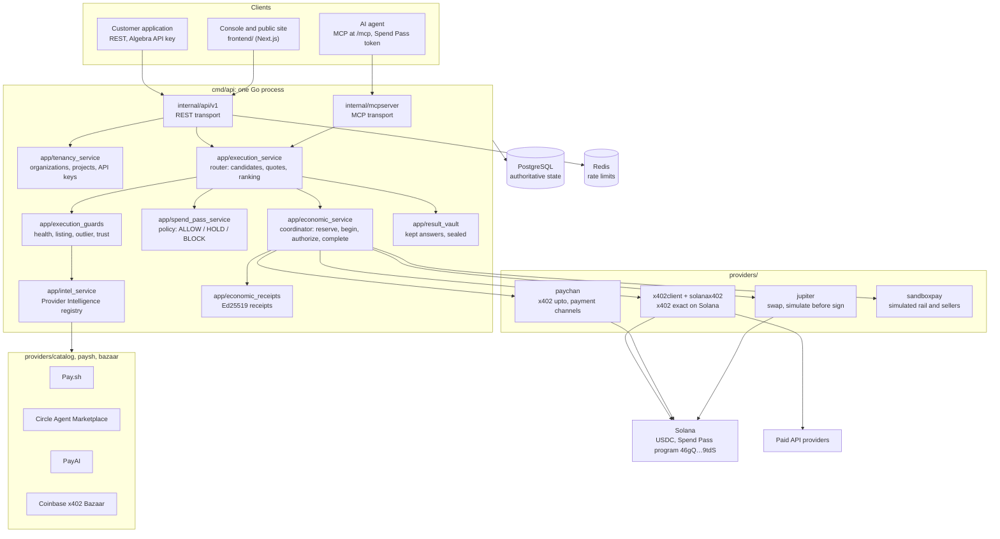
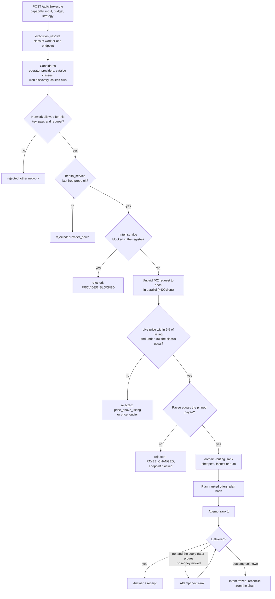
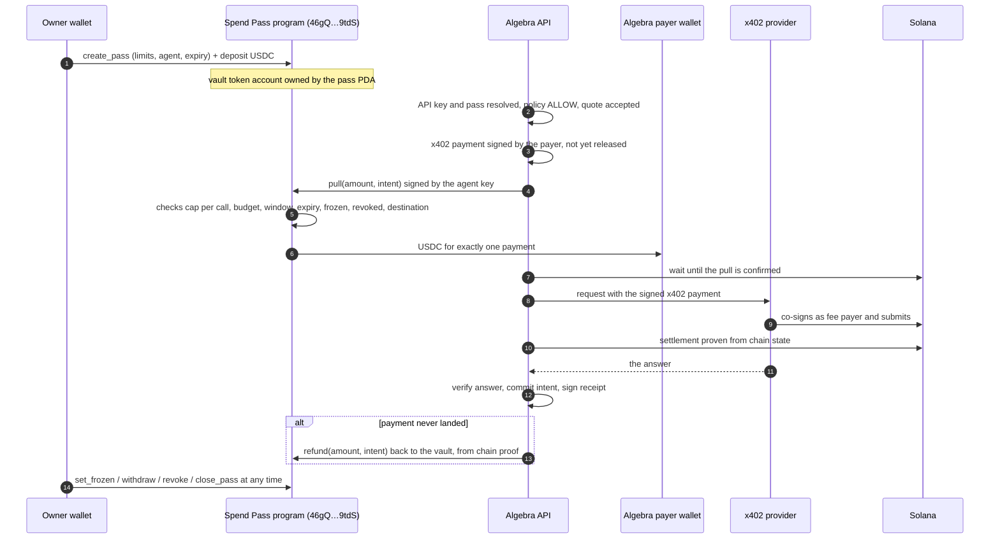
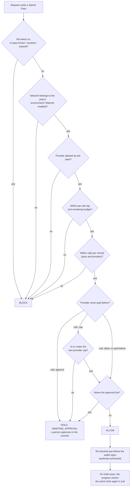
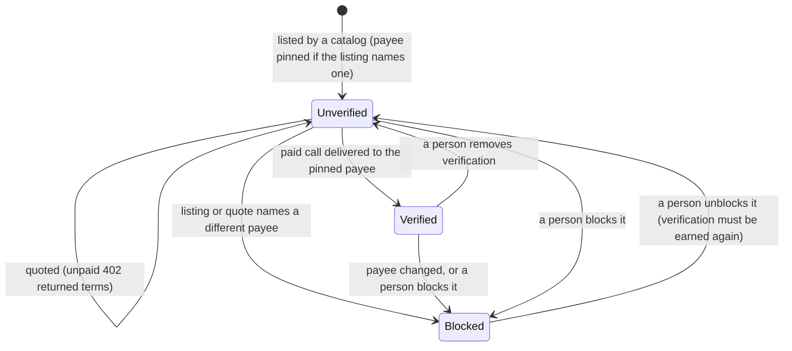
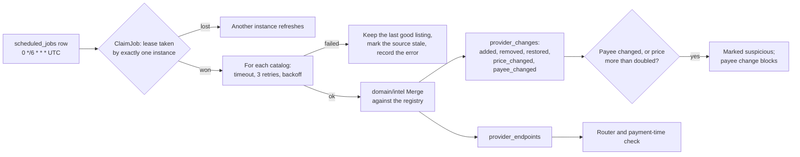
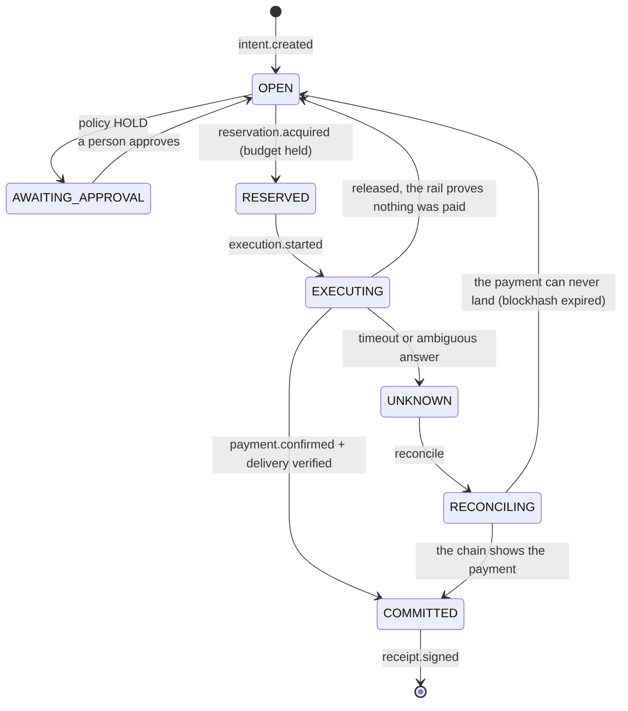
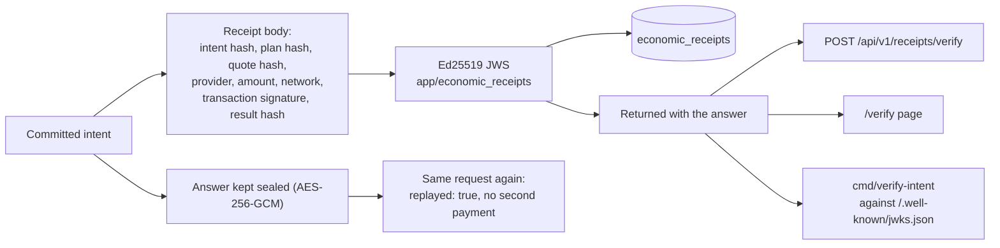

# Diagrams

Six diagrams of what is built, as Mermaid source (GitHub renders it). Every box
names a module in this repository; the paths are under `backend/` unless they
start with `solana-program/` or `frontend/`.

## 1. Architecture

## 2. Discovery and routing

## 3. Solana payment through an on-chain Spend Pass

## 4. Policy decisions

The model never takes part in this decision. It can propose a request; the
pass, the coordinator and the program decide.

## 5. Provider verification

## 6. Receipts and reconciliation

