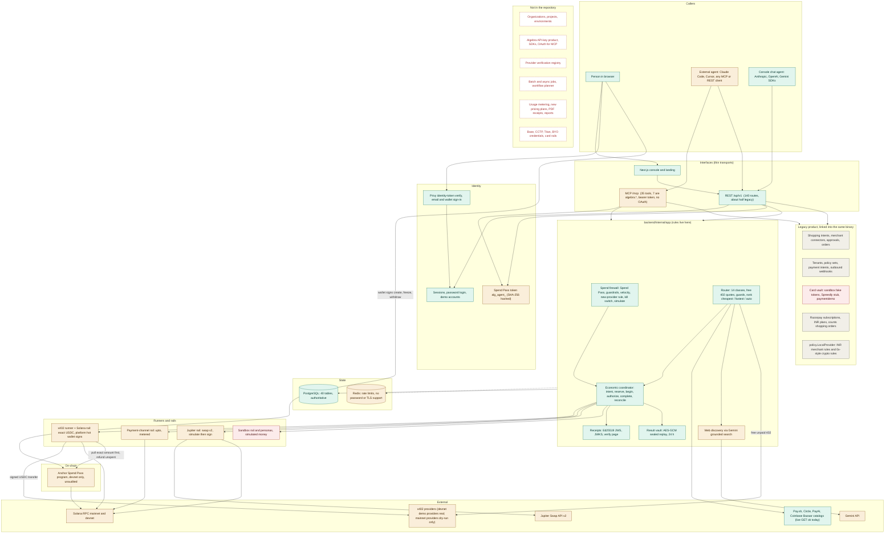
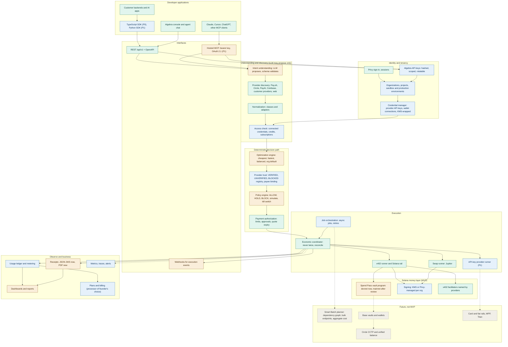

# ALGEBRA AI — Repository Audit Against the Updated B2B Vision

Audited revision: **GitHub `main` = `2368e80`** (branch `submission`, checked out at `E:\solgebra\.data\wt-submission`). Date: 2026-10-12.
Also inventoried, but NOT part of GitHub main: 88 uncommitted paths in the main working folder `E:\solgebra` (branch `solgebra/pivot`, `753c257`). They are listed in Section B.4 and marked UNVERIFIED.

## 0. Method and limits (read first)

**Inspected (code reading):** all backend packages, migrations, router, MCP server, rails, policy engine, Anchor program layout, frontend routes and agent code, docs, CI, env names (names only, no values).

**Executed earlier in this session at this exact revision (not re-run in the audit pass):**
- Go: `gofmt -l` clean, `go vet`, `go build`; 61 packages pass with no database, and again with a scratch Postgres, including 22 end-to-end tests over real HTTP and MCP.
- Frontend: `eslint`, `tsc --noEmit`, `next build` pass.
- Solana program: `cargo build-sbf`, 13 unit tests, 8 LiteSVM tests of the built binary pass.
- GitHub Actions on `2368e80`: 6 of 6 jobs green.
- Secret scan of the commits: 0 real values.

**Executed in this audit (all read-only):** `go list -deps` reachability analysis; four free unauthenticated GETs to public catalogs (no payment, no key); grep and file inspection.

**Not done, by instruction:** no application files modified, nothing installed, no migrations, no deploy, no payment/swap/signing, no paid call, no secret printed. The only file created is this report, outside the app code.

**Status vocabulary:** IMPLEMENTED · PARTIALLY IMPLEMENTED · MOCKED / DEMO ONLY · NOT IMPLEMENTED · BROKEN / BLOCKED · UNVERIFIED. "IMPLEMENTED" means the code supports the stated capability and a test or documented devnet run demonstrates it. It never means "production-ready".

---

## SECTION A — EXECUTIVE SUMMARY

**What Algebra currently is.** A working devnet-grade prototype of the *execution core* of the new vision: a Go backend (REST plus hosted MCP), a Next.js console with an LLM agent chat, and an Anchor program on Solana devnet. An agent (via MCP, REST, or the console chat) states a capability and a price ceiling. Algebra checks the agent's *Spend Pass*, finds candidate providers (four public x402 catalogs grouped into 14 classes, plus Gemini web discovery), asks each for its real price with a free unpaid HTTP 402, drops bad providers with guards, ranks (cheapest, fastest, or auto, which is the weighted "balanced" mode), reserves exactly one live attempt in Postgres, has a platform-held Solana wallet sign a validated x402 USDC payment (optionally funded by an on-chain Spend Pass pull), calls the provider, proves settlement from chain state, and returns the answer with an Ed25519-signed receipt.

**What genuinely works (evidence in Section D and Appendix Q):**
- Discovery from Pay.sh, Circle Agent Marketplace, PayAI and Coinbase x402 Bazaar. All four answered today (HTTP 200); Pay.sh reports 75 providers.
- Live-quote routing with guards and ranking; a deterministic server-side spend firewall; kill switch; dry-run endpoint.
- A "never pays twice" coordinator whose invariants are Postgres constraints, with reconciliation of ambiguous outcomes from chain evidence.
- Real x402 `exact` and metered `upto` payments on Solana **devnet**, and an on-chain Spend Pass (Anchor, devnet) that holds funds, enforces limits, and refunds unspent pulls.
- Privy sign-in, hosted MCP over HTTP with bearer tokens, signed receipts anyone can verify, 803 Go test functions, green CI.

**Maturity:** an **MVP / demo on devnet**. Not production-ready. No real mainnet payment has ever been made; the on-chain program is not on mainnet and is unaudited; the swap rail has only run against a fake cluster.

**Distance from the new vision.** The *engine* (Discover, Optimize, much of Guard, Execute for x402 and swaps, receipts) is close to the vision. The *business platform around it* is largely absent: no organizations, projects, or sandbox/production environments; no Algebra-API-key product (today's credential is a per-agent Spend Pass token); no SDKs; no OAuth for hosted MCP; no bring-your-own provider credentials; no provider verification registry or blue check; no workflow decomposition, batching, or async jobs; no usage metering or plan billing for the new product; no PDF receipts or reports; no Base or CCTP; and customer-owned signing is only partly there (a platform hot wallet still signs).

**Biggest strengths:** a deterministic firewall and coordinator that do not depend on the LLM; real chain-proven settlement semantics; an extensible `Rail` / `StepRunner` design (Jupiter was added without touching the coordinator); strong test discipline; an on-chain limit vault already on devnet.

**Biggest missing pieces:** a multi-tenant data model (org, project, environment, API keys); provider verification and payee trust; bring-your-own credentials and wallets; usage metering and billing; async and batch orchestration; observability; PDF receipts.

**Also true:** the same binary still contains the old shopping-agent, tenant "agentic payment intent", and Razorpay-billing product (about 68 of 140 route registrations and 28 of 35 MCP tools). It is reachable code, not dead code, and it is both reusable and attack surface.

---

## SECTION B — TECH STACK AND REPOSITORY MAP

### B.1 Stack

| Layer | Technology | Evidence |
|---|---|---|
| Backend | Go 1.26, one module `github.com/project-algebra/algebra`, modular monolith | `backend/go.mod`; 444 Go files, about 52.6k LOC non-test, 27.5k LOC test |
| Direct Go deps | `pgx/v5`, `go-redis/v9`, `modelcontextprotocol/go-sdk v1.7.0`, `x/crypto`, `x/oauth2`, `google/uuid`, `godotenv`. **No Solana SDK**: transaction encoding, base58, PDA derivation and ed25519 signing are hand-written in `internal/platform/solana` | `go.mod` |
| Frontend | Next.js 16.3.5, React 19.2.8, Tailwind 4, `motion`, `@privy-io/react-auth` 3.47, `@solana/kit`, Anthropic / OpenAI / Google GenAI SDKs | `frontend/package.json`; 107 TS/TSX files, about 12.8k LOC |
| On-chain | Anchor 1.1.2 program (Rust), LiteSVM tests; legacy SPL Token (USDC) | `solana-program/programs/spend-pass`; 13 Rust files, about 1.35k LOC |
| Data | PostgreSQL 16 (authoritative), Redis 7 (rate limits and locks only) | `deploy/docker-compose.yml`; `migrations/` (20 files, 40 tables) |
| Packaging / CI | Dockerfiles for backend and frontend, compose with profiles, GitHub Actions (6 jobs) | `backend/Dockerfile`, `frontend/Dockerfile`, `.github/workflows/ci.yml` |
| Observability | `slog` JSON logs with redaction, request IDs, append-only `economic_events` and `audit_events`, `/healthz`, `/readyz`. **No** metrics, tracing, or error tracker | grep: no prometheus / otel / sentry in Go or frontend deps |

### B.2 Services, entry points, important directories

| Entry point | Purpose |
|---|---|
| `backend/cmd/api` | REST API + MCP server at `/mcp` + sandbox providers + background loops (session purge, result purge, 15 s economic sweeper, on-chain pull reconciler, provider health probes) |
| `backend/cmd/mcp` | the same MCP tools over stdio (or standalone HTTP) |
| `backend/cmd/demo-provider` | paid x402 demo APIs on devnet that behave like real ones (honest, slow, down, overcharging, trap, metered) |
| `backend/cmd/spend-pass`, `solana-wallet`, `x402-dryrun`, `verify-intent`, `paychan-smoke`, `monid-import`, `merchant-login` | operator and developer tools (`x402-dryrun` prices and simulates, never sends) |
| `frontend/` | landing, auth, console (`/console/{agent,passes,providers,routing,firewall,executions,connect,settings}`), `/verify`, two Next route handlers `/api/agent/{chat,providers}` |

Core execution files (new product):
- `backend/internal/app/economic_service.go` (1,404 lines): coordinator (create, reserve, begin, authorize, complete, reconcile, sweep).
- `backend/internal/app/execution_service.go` (986 lines) plus `execution_{request,resolve,guards,eval,replay,history,classes}.go`: router, quoting, plan, replay, simulate.
- `backend/internal/domain/routing/{rank,candidate,quote,plan,classes}.go`: pure ranking and class definitions.
- `backend/internal/domain/{econ,spendpass,receipt,chain}` and `backend/policy/`: domain rules and the public rule engine.
- `backend/providers/{x402client,solanax402,paychan,jupiter,sandboxpay,paysh,bazaar,catalog,webdiscovery,monid}`: runners, rails, catalogs.
- `backend/internal/app/onchain_passes.go`, `internal/platform/solana/spendpass`, `solana-program/programs/spend-pass`: on-chain pass.
- `backend/internal/api/v1/*.go` (REST, thin) and `backend/internal/mcpserver/*.go` (MCP, thin).
- `frontend/lib/agent/*` and `frontend/components/console/agent/*`: the LLM agent.

Dependency direction (verified with `go list -deps`): `cmd` → `wiring` → `app` → `domain` (interfaces); providers and platform code are injected by `internal/platform/wiring`. 80 of 84 Go packages are reachable from some `cmd`; the four that are not are test helpers or an example (`examples/kite-wallet`, `solanatest`, `jupitertest`). **Nothing is dead; the legacy product is linked into the same API binary.**

### B.3 API surface (140 route registrations in `backend/internal/api/v1/router.go`)

- **New product (about 70):** `POST /api/v1/execute`; `/economic-intents/*` (create, reserve, begin, authorize-payment, complete, release, reconcile, receipt, execute, executions, result); `/me/economic-intents*` (list, stats, approve, cancel); `/me/passes*` (create, revoke, freeze, controls, on-chain prepare/link/tx); `/policy/simulate`; `/me/killswitch`; `/pass`; `/providers`; `/classes*` (list, health, probe); `/discover/web`; `/rails`; `/receipts/verify`; `/.well-known/jwks.json`; `/sandbox/x402/*`; `/auth/*` (login, signup, demo, privy, agent-token, OAuth, password reset); `/me*` (profile, sessions, export, delete, guardrails, onboarding); `/mcp`; `/healthz`; `/readyz`.
- **Legacy (about 68):** `/intents/*` (shopping purchase flow), `/approvals/*`, `/payment-sources*`, `/merchants`, `/profiles/*`, `/commerce-profile*`, `/payment-intents/*` (tenant B2B payment intents), `/tenants*`, `/integrators*`, `/policy/evaluate-transaction`, `/transactions`, `/search`, `/web-search`, `/deals`, `/community-deals`, `/billing*` (Razorpay), `/webhooks/{provider}`, `/users`, `/agents`.
- **MCP:** 35 tools. 7 are `algebra.*` (`execute`, `simulate`, `classes`, `discover_providers`, `discover_web`, `execution_status`, `spend_pass`). 28 are legacy (`commerce.*` ×14, `payments.*` ×7, `policy.*` ×3, `profiles.*` ×4).

### B.4 In the main folder but NOT on GitHub main (UNVERIFIED, uncommitted, authored by other sessions)

| Path | What the code or its doc says it is |
|---|---|
| `backend/internal/platform/gcpkms/` | Cloud KMS signer: "Private signing keys never enter this process"; raw Ed25519 signing verified locally by `solana.Keypair` |
| `deploy/gcp/` (`main.tf`, `production.tfvars.example`) | Terraform for Cloud Run, HA Postgres/Redis, KMS, HTTPS, alerts. Per its doc: "Terraform validates"; never applied |
| `backend/internal/app/onchain_recipients.go`, `solana/spendpass/recipients.go`, `solana-program/pinocchio/src/recipients.rs` | recipient allow-list for on-chain passes (restricted payments via an Instructions-sysvar guard) |
| `backend/cmd/release-check/` | read-only chain-state release check |
| `frontend/components/console/{privy-vault-wallet,provider-detail,agent-quickstart,spend-pass-credential}.tsx`, `frontend/app/console/providers/[id]/` | Privy embedded-wallet signing for the vault, provider detail pages, quickstart, credential card UI |
| `backend/internal/api/v1/sandbox_sellers.go` | public list of simulated sellers for demo accounts |
| `docs/RELEASE_WALKTHROUGH.md` | states: "program/backend/UI/KMS changes are implemented locally ... No mainnet payment, infrastructure apply, independent program review or live embedded-wallet signing has been completed by this change." |
| 67 modified tracked files | frontend redesign and edits overlapping files changed on main |

These are relevant to Modules A, D, E (KMS, recipient allow-list, Privy wallet) and should be reviewed by the architect before planning, but none can be counted as delivered.

---

## SECTION C — CURRENT END-TO-END ARCHITECTURE (what the code actually implements)

Legend: green = real and demonstrated; amber = partial or devnet-only or untested against the real world; red = mock / demo only; grey = legacy product (works, not part of the new vision); dashed = does not exist.

Reading guide: the new product is one vertical path (`REST|MCP → FW + ROUTER → COORD → rail → chain → RCPT`). Everything in the LEGACY box is reachable through the same router and the same MCP server but is not used by that path. The MISSING box is the delta to the vision.

---

## SECTION D — FEATURE AUDIT MATRIX

Paths are relative to `backend/` unless they start with `frontend/`, `solana-program/` or `docs/`.

### D.A Algebra Connect

| Feature | Status | Existing implementation | Evidence (file / symbol) | Missing | Recommendation |
|---|---|---|---|---|---|
| Sign up / sign in | IMPLEMENTED | Privy (wallet or email code), email+password (argon2id), one-click demo, OAuth endpoints (UI buttons removed) | `internal/api/v1/auth.go` `privySignIn`, `signIn`, `signUp`, `startDemo`; `internal/app/account_service.go`; e2e `TestPrivySignInOverHTTP` | SSO/SAML, MFA, team invites | KEEP AND IMPROVE |
| Privy authentication | IMPLEMENTED (sign-in only) | ES256 identity-token verification against the app key or JWKS; wallets recorded in `user_wallets` | `internal/platform/identity/privy.go` `VerifyIdentityToken`; `internal/app/account_privy.go` `SignInWithPrivy`; `migrations/0019_user_wallets.sql`; `frontend/components/auth/privy-sign-in.tsx` | Privy server wallets, policies, signing (a client-side vault wallet UI exists only uncommitted) | KEEP AND IMPROVE |
| Organizations | NOT IMPLEMENTED (new model) | Legacy `tenants` = a B2B root token that owns end users (`users.tenant_id`) | `internal/domain/tenant/tenant.go`; `migrations/0003_tenants.sql`. Economic tables use `principal_id` = user, no org column | org, membership, roles | REFACTOR / REUSE the tenant concept as the org root |
| Projects, sandbox/production environments | NOT IMPLEMENTED | Only process-level `APP_ENV`, rail per network, `ECONOMIC_SANDBOX` flag | `internal/platform/config/config.go` | project and environment entities, per-env keys, per-env limits | new module |
| Scoped Algebra API keys: create, store, rotate, revoke | PARTIALLY IMPLEMENTED | Per-agent bearer token `alg_agent_...`, shown once, SHA-256 hash stored, revoked with its pass. Legacy tenant and integrator tokens use the same helper | `internal/domain/agent/agent.go` `GenerateToken`, `HashToken`; `POST /api/v1/me/passes`; `internal/domain/tenant/tenant.go` | rotation, per-key expiry, scopes beyond the pass, last-used, per-project keys, key listing | KEEP AND IMPROVE |
| Hosted MCP server | IMPLEMENTED (code); no public instance exists | Stateless streamable HTTP at `/mcp`, bearer token, same services as REST | `internal/mcpserver/server.go`; `internal/api/v1/router.go` `mux.Handle("/mcp"...)`; e2e `TestMCPOverHTTP_AnAgentExecutesThroughTheSandboxWithItsPassToken`, `TestMCPOverHTTP_NoTokenNoPayment` | a deployment; OAuth | KEEP AND IMPROVE |
| OAuth for hosted MCP clients | NOT IMPLEMENTED | none (docs say so) | `docs/MCP.md` ("OAuth 2.1 sign-in ... is not built") | authorization server or Privy/host OAuth | new module |
| TypeScript / Python SDK | NOT IMPLEMENTED | only a dev dependency `openapi-typescript` and `backend/openapi/execution.yaml` | `frontend/package.json` | both SDKs | generate from OpenAPI |
| Webhooks | PARTIALLY IMPLEMENTED (legacy only) | Outbound, HMAC-signed, retried, for tenant payment intents; inbound `/webhooks/{provider}` rejects unsigned | `internal/app/webhook_dispatch_service.go` `Dispatch`, `deliverWithRetry`; `internal/api/v1/webhooks.go` | events for economic intents, per-org endpoints, delivery log | REFACTOR / REUSE |
| Developer docs | PARTIALLY IMPLEMENTED | 22 Markdown docs, OpenAPI file | `docs/*.md`, `backend/openapi/execution.yaml` | docs site, SDK reference, stale statements (Appendix R) | KEEP AND IMPROVE |
| First-execution sandbox walkthrough | PARTIALLY IMPLEMENTED | Sandbox rail with 5 provider personas; demo account; chat suggestions; runbook | `providers/sandboxpay/personas.go`; `docs/DEMO.md`; `frontend/components/console/agent/workspace.tsx` | guided onboarding; demo account starts with no pass | KEEP AND IMPROVE |
| Customer-connected provider credentials (BYO keys) | NOT IMPLEMENTED | Only legacy merchant OAuth sessions (Zepto, Swiggy), AES-GCM under the master key | `connectors/remotemcp`; `MERCHANT_SESSION_DIR` | credential vault, per-org encryption, scoping, rotation | new module, reuse `privacy.AESGCMEncryptor` |
| Customer Solana wallets | PARTIALLY IMPLEMENTED | Owners connect wallets (Wallet Standard) to sign on-chain pass transactions; public addresses stored. Algebra's payer wallets are server keypairs | `frontend/lib/onchain-pass.ts`; `migrations/0019`; `internal/platform/config/config.go` `SOLANA_*_KEYPAIR_FILE` | customer-owned signing for payments (not just vault admin) | KEEP AND IMPROVE |
| Base wallets, other payment methods | NOT IMPLEMENTED | network name constants only | `internal/domain/chain/chain.go` | everything | DEFER |

### D.B Algebra Discover

| Feature | Status | Existing implementation | Evidence | Missing | Recommendation |
|---|---|---|---|---|---|
| Natural-language request understanding | PARTIALLY IMPLEMENTED | Only in the frontend LLM agent (tools `route_work`, `check_policy`, `search_providers`, `get_provider_endpoints`, `pay_and_call`, `run_approved_intent`, `execution_status`, `ask_user`). The backend takes structured `capability` + `input` | `frontend/lib/agent/tools.ts`, `execute-tool.ts` `executeTool`; `POST /api/v1/execute` | server-side intent parsing (so SDK/MCP users get it too) | KEEP AND IMPROVE |
| pay.sh discovery | IMPLEMENTED | Reads `https://pay.sh/api/catalog`; live GET returned 200, 75 providers (generated 2026-10-08) | `providers/paysh/paysh.go` `DefaultCatalogURL` | endpoint-level auth metadata | KEEP AS IS |
| Circle Agent Marketplace discovery | IMPLEMENTED | Reads Circle's public x402 discovery endpoint; live GET 200 | `providers/bazaar/bazaar.go` (Circle), `providers/catalog/` | many listings are Base-only (`eip155:8453`) and not payable | KEEP AS IS |
| PayAI and Coinbase x402 Bazaar discovery | IMPLEMENTED | same package; live GETs 200 | `providers/bazaar/bazaar.go` | same | KEEP AS IS |
| Capability normalization | IMPLEMENTED | 14 classes, regex membership from catalog text, per-provider input adapters (README: 661 endpoints, 280 routable; not re-counted in this audit) | `internal/domain/routing/classes.go`; `internal/app/execution_classes.go`; `internal/app/capabilities.go` `DefaultCapabilities` | hand-maintained; membership inferred from third-party text | KEEP AND IMPROVE |
| Detect payment methods | PARTIALLY IMPLEMENTED | Parses 402 `accepts` (scheme, network, asset, payTo), keeps Solana USDC options | `providers/x402client/runner.go` `options` | MPP, API-key, fiat, subscription detection | KEEP AND IMPROVE |
| Provider auth requirements | NOT IMPLEMENTED | `ExecHTTPAPI`, `ExecMCP`, `ExecMPP` constants exist, no runner registered | `internal/domain/routing/candidate.go`; `wiring.go` registers only x402 and solana_swap runners | credential requirement modelling | new module |
| Check whether the business already has access | NOT IMPLEMENTED | none | n/a | subscriptions, credits, connected accounts | new module |
| Transparent pricing | IMPLEMENTED | Live quote, listing price, honesty flag, rejected providers with reasons, plan with scores | `internal/domain/routing/{quote,plan,rank}.go`; `/execute` and `/policy/simulate` responses | Algebra fee line | KEEP AS IS |
| Reject unsupported execution paths | IMPLEMENTED | `routing.Reject*` codes; `ErrNoRoute` with the rejected list | `internal/domain/routing/plan.go` | none | KEEP AS IS |
| Customer-connected providers | PARTIALLY IMPLEMENTED | operator JSON `ECONOMIC_PROVIDERS`; agent-supplied `candidates` treated unverified | `internal/platform/wiring` `ParseConfiguredProviders`; `internal/app/execution_request.go` | per-org provider registry | new module |

### D.C Algebra Optimize

| Feature | Status | Existing implementation | Evidence | Missing | Recommendation |
|---|---|---|---|---|---|
| Cheapest | IMPLEMENTED | `ModeCheapest` ranks by live total cost | `internal/domain/routing/rank.go` `Rank` | none | KEEP AS IS |
| Fastest | IMPLEMENTED | `ModeFastest` ranks by expected time from Algebra's own record | same | none | KEEP AS IS |
| Balanced | PARTIALLY IMPLEMENTED | `ModeAuto` is a weighted score (cost, latency, reliability, quality, trust 0.10, price honesty) with fixed constant weights | `rank.go` `autoWeights`, `trustScore` | name it `balanced`; configurable weights | KEEP AND IMPROVE |
| Ask which mode when missing | PARTIALLY IMPLEMENTED | Default is auto; only the chat LLM can `ask_user` | `frontend/lib/agent/tools.ts` | a deterministic API state "preference required"; org default | KEEP AND IMPROVE |
| Org default policy | NOT IMPLEMENTED | strategy is per request (`provider_policy.strategy`) | `internal/domain/econ` Spec | org/project defaults | new module |
| Total cost including fees, gas, slippage | PARTIALLY IMPLEMENTED | `routing.Cost` has provider, network fee, bridge fee, slippage; x402 fee is sponsored so usually provider price only; swaps carry slippage | `internal/domain/routing/quote.go` `Cost.Total` | on-chain pull SOL fees, Algebra fee, settlement fees | KEEP AND IMPROVE |
| Measured latency | IMPLEMENTED | health probes (15 min) and per-attempt records | `internal/app/execution_history.go`; `migrations/0015_route_executions.sql`, `0018_provider_health.sql` | percentiles, SLOs | KEEP AS IS |
| Reliability | IMPLEMENTED | observed success rate with a prior; unreliable (<50%) go last | `rank.go` `priorReliability`, `unreliableBelow` | none | KEEP AS IS |
| Provider rate limits, data freshness, credits, subscriptions | NOT IMPLEMENTED | only Algebra-side velocity per pass and per provider | `internal/domain/spendpass/controls.go` | provider-side limits, freshness field (`SemanticQuality`, `Freshness` explicitly left unjudged) | new module |
| Deterministic enforcement over the LLM | IMPLEMENTED | `Rank` is pure; `screen` and the pass re-check at reserve and again at payment | `internal/app/execution_service.go` `screen`; `economic_service.go` | none | KEEP AS IS |

### D.D Algebra Guard

| Feature | Status | Existing implementation | Evidence | Missing | Recommendation |
|---|---|---|---|---|---|
| Deterministic policy engine | IMPLEMENTED | Pure function engine plus Spend Pass evaluation; DENY > REQUIRE_APPROVAL > ALLOW, all reason codes kept | `policy/provider.go` `Decision`, `merge`; `policy/local_provider.go`; `internal/domain/spendpass/pass.go` `Evaluate`, `Combine`; 26 unit tests | rules are INR-merchant shaped; crypto rules compare strings and document "0x ... 42 chars" | REFACTOR / REUSE |
| ALLOW / HOLD / BLOCK | IMPLEMENTED under other names | ALLOW, REQUIRE_APPROVAL (the HOLD: intent state `AWAITING_APPROVAL`), DENY (the BLOCK) | `policy.Decision`; `internal/domain/econ` states | rename in API for the new vocabulary | KEEP AND IMPROVE |
| LLM cannot raise limits or approve | IMPLEMENTED | Approvals, pass edits, kill switch are session-only; agent tokens are refused | `internal/api/v1/economic.go` `approveMyEconomicIntent` (rejects any `Authorization` header); tests `TestEconomic_ApprovalIsHumanOnly`, `TestEconomic_AgentCannotSelfCertify` | none | KEEP AS IS |
| Provider verification: VERIFIED / UNVERIFIED / BLOCKED, blue check | NOT IMPLEMENTED | Only `routing.Trust` (native, observed, listed, unverified) feeding a 0.10 rank weight and the new-provider rule | `internal/domain/routing/candidate.go` `Trust`; `rank.go` | identity claim, endpoint-control proof, payTo binding, registry, UI state | new module (highest-value gap in Guard) |
| Block known-malicious providers | PARTIALLY IMPLEMENTED | per-user `blocked_merchants` guardrail, per-pass allow-list, price and health guards | `internal/domain/account/guardrails.go`; `internal/domain/spendpass/pass.go` `ReasonMerchantNotAllowed` | global deny list, reputation feed, org-level blocklist | KEEP AND IMPROVE |
| Seller impersonation | PARTIALLY IMPLEMENTED | in open directories provider IDs derive from the host, not the claimed name | `docs/THREAT_MODEL.md` E4; `providers/bazaar` | ownership proof | new module |
| Payment-destination manipulation | PARTIALLY IMPLEMENTED | between quote and payment payee, asset, scheme must match and price may not rise; the rail refuses payee = own wallet, wrong asset, amount over ceiling or hold | `providers/x402client/runner.go` `sameTerms`; `providers/solanax402/rail.go` `Authorize` | no check that the payee belongs to the provider | KEEP AND IMPROVE |
| Unsafe transaction instructions | IMPLEMENTED for existing rails | x402 transaction is built by Algebra (compute budget, one TransferChecked, memo); a Jupiter transaction is simulated and its account deltas judged before signing | `providers/solanax402/rail.go`; `providers/jupiter/rail.go` `judge`; e2e `TestSwapOverHTTP_ATransactionThatDoesMoreThanItSaysIsNeverSigned` | generalised transaction firewall for other adapters | KEEP AS IS |
| Prompt injection | PARTIALLY IMPLEMENTED | provider and catalog text bounded, sanitised and labelled untrusted; web discovery takes only an address from the model | `docs/THREAT_MODEL.md` E5, E15; `execute-tool.ts` (`response_is_untrusted_provider_data`) | structured-output enforcement for the chat agent | KEEP AND IMPROVE |
| Price changes | IMPLEMENTED | live price vs listing (over 5% rejected), over 10x class median rejected, re-check before payment | `internal/app/execution_guards.go`; `x402client` `sameTerms` | none | KEEP AS IS |
| Replay and duplicate payments | IMPLEMENTED | `UNIQUE(principal_id, effect_key)`, partial unique indexes for one live and one committed reservation, single-use payment authority per attempt, compare-and-set on pull state | `migrations/0014_economic_intents.sql`; `economic_service.go` `AuthorizePayment`; `internal/app/onchain_passes.go` | none found | KEEP AS IS |
| Excessive permissions | PARTIALLY IMPLEMENTED | pass scope; legacy agent permission list | `internal/domain/agent/agent.go` `Permission` | per-key scopes for the new surface | KEEP AND IMPROVE |

### D.E Algebra Pay

| Feature | Status | Existing implementation | Evidence | Missing | Recommendation |
|---|---|---|---|---|---|
| Solana USDC via x402 (`exact`) | IMPLEMENTED on devnet; mainnet UNVERIFIED | rail builds, signs, and later proves settlement from chain state | `providers/solanax402/rail.go` `Authorize`, `Settlement`; devnet transactions in `docs/DEMO.md` and `docs/SPEND_PASS_PROGRAM.md` (the 13 Anchor-program transactions were each checked finalized earlier this session) | any real mainnet payment | KEEP AND IMPROVE |
| Usage-based `upto` | IMPLEMENTED on devnet | Solana payment-channels program: escrow, voucher, settle and refund | `providers/paychan/`, `providers/solanax402/upto.go`; `cmd/paychan-smoke` | mainnet; provider adoption | KEEP AS IS |
| x402 facilitators | PARTIALLY IMPLEMENTED | Uses whichever fee payer the provider's requirements name (`extra.feePayer`); the demo provider is its own facilitator | `solanax402/rail.go` | facilitator allow-list, Algebra-run or integrated facilitator | KEEP AND IMPROVE |
| Customer-funded payments | PARTIALLY IMPLEMENTED | On-chain Spend Pass: owner's wallet funds a vault; Algebra's payer pulls one payment at a time, program enforces limits, unspent pulls refunded | `solana-program/programs/spend-pass`; `internal/app/onchain_passes.go` `Fund`, `Reconcile`; 13 unit + 8 LiteSVM tests | mainnet, audit, customer-owned payer instead of one platform wallet | KEEP AND IMPROVE |
| Solana vault | IMPLEMENTED on devnet | PDA per pass with an associated token vault; 9 instructions | `solana-program/programs/spend-pass/src/lib.rs`; program `46gQDUuJCt6VdDMaguGPoD8SKEtFqvpG7ECtpC2F9tdS` | mainnet (not deployed), independent review | KEEP AND IMPROVE |
| Base vault, Base wallets, CCTP, unified balance | NOT IMPLEMENTED | none | n/a | everything | DEFER |
| Separation: identity / credentials / authorization / vault / settlement / execution | PARTIALLY IMPLEMENTED | clean in code (accounts, pass tokens, pass policy, on-chain vault, rails, runners) except one platform payer key per cluster | `internal/app/*`, `providers/*` | per-org payer or per-org vault authority | REFACTOR / REUSE |
| Key custody | PARTIALLY IMPLEMENTED | keypair from file or env; `Keypair` redacts itself in logs and JSON; never reaches the LLM path. A KMS signer exists only uncommitted | `internal/platform/solana/keys.go` `Format`, `MarshalJSON`; `config.go`; `internal/platform/gcpkms` (uncommitted) | KMS/HSM in main, per-customer keys | new module (reuse uncommitted `gcpkms`) |

### D.F Algebra Execute

| Feature | Status | Existing implementation | Evidence | Missing | Recommendation |
|---|---|---|---|---|---|
| Paid API request flow | IMPLEMENTED (devnet) | discover, quote, policy, authorise, call, validate, receipt | `internal/app/execution_service.go`; e2e `TestRouterOverHTTP_AClassIsPaidToTheBestHonestProvider` (sandbox) | mainnet proof | KEEP AND IMPROVE |
| Response validation | PARTIALLY IMPLEMENTED | JSON well-formedness and the capability's output schema when one is declared; semantic quality and freshness deliberately unjudged | `internal/app/execution_eval.go` `GenericEvaluator` | per-capability schemas for most classes | KEEP AND IMPROVE |
| Solana swap | PARTIALLY IMPLEMENTED | Jupiter Swap v2: order, simulate, sign only if accounts change as promised, execute, settle from chain; buy-with-USDC only; off by default | `providers/jupiter/{client,rail,runner,swap}.go`; e2e `TestSwapOverHTTP_*` against fake cluster and fake Jupiter | landing on a real cluster; selling, SOL; multi-aggregator comparison | KEEP AND IMPROVE |
| Titan or other swap adapters | NOT IMPLEMENTED | none (grep: no "titan") | n/a | adapter plus a comparison step | new module on the `StepRunner` interface |
| API-key providers (Case 2), fiat-only providers (Case 3) | NOT IMPLEMENTED | none | `ExecHTTPAPI` constant only | credential vault, runner | new module |
| Decline unsupported execution with an explanation | IMPLEMENTED | `ErrNoRoute` with rejected list and reasons; HTTP 422 | `internal/api/v1/economic.go` `writeEconError` | none | KEEP AS IS |
| Partial-failure handling inside one outcome | IMPLEMENTED | fallbacks only after proof that no money moved; ambiguous outcomes freeze and reconcile | `economic_service.go` `Sweep`, `Reconcile`; `TestEconomic_PostPaymentTimeoutFreezesAndReconciles` | multi-operation workflows (Module G) | KEEP AS IS |

### D.G Algebra Smart Batch

| Feature | Status | Existing implementation | Evidence | Missing | Recommendation |
|---|---|---|---|---|---|
| Break a request into operations, dependency graph | NOT IMPLEMENTED | one outcome per request | `POST /execute` | planner | new module |
| Concurrency within limits | PARTIALLY IMPLEMENTED (building block) | quotes for up to 12 candidates are fetched concurrently | `execution_service.go` quoting | job-level concurrency and rate limiting | new module |
| Deduplicate, reuse cached data | PARTIALLY IMPLEMENTED | identical outcome = same intent; committed answers replayed from a sealed 24 h vault | `internal/app/result_vault.go`; `execution_replay.go` | cross-request cache policy, TTL by data type | KEEP AND IMPROVE |
| Native bulk endpoints, aggregate cost comparison, job progress, async | NOT IMPLEMENTED | none; requests are synchronous (up to about 80 s) | `docs/PRODUCTION.md`; `cmd/api/main.go` loops are sweepers only | job table, workers, progress API | new module |
| Pay-once-on-retry for batches | PARTIALLY IMPLEMENTED | holds at the single-outcome level via effect key and CAS | `economic_service.go` | batch-level idempotency | KEEP AND IMPROVE |

### D.H Algebra Observe

| Feature | Status | Existing implementation | Evidence | Missing | Recommendation |
|---|---|---|---|---|---|
| Per-execution record: request ID, agent, provider, endpoint, optimisation decision, policy decision, estimated and actual cost, network, signature, status, latency, retries, authorisation state | IMPLEMENTED (except org/project) | append-only `economic_events`; `route_executions`; receipts carry routing, execution, settlement, coordination | `migrations/0014`, `0015`; `internal/app/economic_receipts.go`; `internal/domain/receipt` | organisation ID, project ID, Algebra service charge | KEEP AND IMPROVE |
| JSON receipts | IMPLEMENTED | Ed25519 JWS, JWKS, `POST /receipts/verify`, `/verify` page, `cmd/verify-intent` | `internal/domain/receipt/`; `GET /api/v1/economic-intents/{id}/receipt` | none | KEEP AS IS |
| PDF receipts | NOT IMPLEMENTED | none (no PDF code anywhere) | grep | renderer | INTEGRATE a library |
| Consolidated reports | NOT IMPLEMENTED | stats endpoint only | `myEconomicStats` | CSV/PDF reports, date ranges | new module |
| Usage dashboards | PARTIALLY IMPLEMENTED | console Executions and Routing pages | `frontend/app/console/executions`, `routing` | org-level analytics | KEEP AND IMPROVE |
| Operational observability | NOT IMPLEMENTED | logs only | B.1 | metrics, traces, alerts | INTEGRATE |

### D.I Algebra Business Platform

| Feature | Status | Existing implementation | Evidence | Missing | Recommendation |
|---|---|---|---|---|---|
| Plans Free, Builder, Startup, Business, Enterprise | NOT IMPLEMENTED | legacy plans `developer` (free, 100 executions a month hard limit) and `growth` (5,000, INR via Razorpay) | `internal/domain/billing/billing.go`; `providers/razorpay` | new plan catalogue in USD | REPLACE the plan data, KEEP the plumbing |
| Subscription billing | PARTIALLY IMPLEMENTED (legacy) | Razorpay plans, checkout, webhook; no billing or pricing page in the frontend; a comment points to `frontend/components/pricing-tiers.tsx`, which does not exist | `internal/app/billing_service.go`; `/api/v1/billing*` | Stripe or other USD processor, UI | INTEGRATE |
| Usage metering | NOT IMPLEMENTED for economic executions | `CountExecutionsSince` counts shopping **orders** | `internal/platform/postgres/billing_repo.go` | metering of executions, spend, batch size | new module |
| Spending limits | IMPLEMENTED | pass budgets and caps; rail ceilings (1 USDC per x402 payment, 5 USDC per swap) | `internal/domain/spendpass`; `solanax402` config | org-level ceilings | KEEP AND IMPROVE |
| Organisation management, team permissions, advanced policies | NOT IMPLEMENTED | none | n/a | RBAC | new module |
| Book-a-Demo page, lead qualification, 7-day trial | NOT IMPLEMENTED | none | frontend routes | all | new module |
| Basic safety not gated by a plan | IMPLEMENTED | no plan checks in the firewall or coordinator | `economic_service.go` | keep it this way | KEEP AS IS |

---

## APPENDIX Q — THE 30 AUDIT QUESTIONS (Part 6), with evidence

Confidence: High = read in code and exercised by a passing test or documented chain transaction; Medium = read in code, not exercised against the real world; Low = inferred.

| # | Question | Status | Evidence and file / symbol | Conf. | Limitations |
|---|---|---|---|---|---|
| 1 | Working AI agent? | IMPLEMENTED | Console chat: `frontend/app/api/agent/chat/route.ts` `POST`; model drivers `frontend/lib/agent/providers/{anthropic,openai,gemini}.ts` `runTurn`; 8 tools in `frontend/lib/agent/tools.ts`; executor `execute-tool.ts` `executeTool` (calls only Algebra's API) | Medium | Needs a server-side LLM key. During the 2026-10-08 test the Gemini key returned a billing (402) error. Chat caps one call at 5 USDC (`MAX_CALL_USDC`) and a daily message quota |
| 2 | Interprets a natural-language task? | PARTIALLY IMPLEMENTED | Only the frontend LLM maps text to a class and input (`route_work`, `check_policy`). Backend `POST /api/v1/execute` requires structured `capability` + `input` | Medium | SDK and MCP callers get no server-side parsing; the model chooses the class |
| 3 | Real MCP server? | IMPLEMENTED | Official `modelcontextprotocol/go-sdk` v1.7.0; `internal/mcpserver/server.go` (`project-algebra` 0.1.0), mounted at `/mcp`; e2e `TestMCPOverHTTP_*` drive it with the SDK's own client | High | 35 tools, 28 of them legacy |
| 4 | Can Claude, Cursor or ChatGPT connect today? | PARTIALLY IMPLEMENTED / UNVERIFIED | Bearer-header connection documented with snippets for Claude Code, Claude Desktop/Cursor (`mcp-remote`), OpenAI Agents SDK: `docs/MCP.md`, `frontend/app/console/connect/page.tsx` | Medium | No hosted public instance exists. ChatGPT and claude.ai connectors need OAuth, which is not built. Not tried with real clients in this audit |
| 5 | Can developers generate Algebra API keys? | PARTIALLY IMPLEMENTED | A Spend Pass issues `alg_agent_...`, shown once, SHA-256 stored: `internal/domain/agent/agent.go` `GenerateToken`; `POST /api/v1/me/passes` (session only) | High | It is a per-agent spending authority, not an org or project key. No rotation, expiry per key, scopes, last-used |
| 6 | Organizations and projects? | NOT IMPLEMENTED | Economic tables key on `principal_id` = user (`migrations/0014`). Legacy `tenants` is a different, older model (`internal/domain/tenant`) | High | none |
| 7 | Privy authentication exists? | IMPLEMENTED | `internal/platform/identity/privy.go` `VerifyIdentityToken`; `POST /api/v1/auth/privy`; `frontend/components/auth/privy-sign-in.tsx`; e2e `TestPrivySignInOverHTTP` | High | Sign-in only on main. Privy server wallets, policies, signing: no |
| 8 | Wallets created, connected, or only visual? | PARTIALLY IMPLEMENTED | Created: Privy makes an embedded Solana wallet client-side for users without one; addresses are stored (`user_wallets`, `internal/app/account_privy.go`). Connected: Wallet Standard in the console signs on-chain pass transactions (`frontend/lib/onchain-pass.ts`). Algebra's own payer wallets are server keypairs | High | On main, Algebra never signs payments with a user's wallet |
| 9 | Solana vault implementation? | IMPLEMENTED (devnet) | `solana-program/programs/spend-pass/src/lib.rs`, 9 instructions; Go client `internal/platform/solana/spendpass`; service `internal/app/onchain_passes.go`; migration 0020; tests 13 unit + 8 LiteSVM | High | Devnet only, upgrade authority is one key, not audited, not on mainnet (checked on chain). It is a per-pass limit vault, not a general treasury |
| 10 | Base vault? | NOT IMPLEMENTED | none; `chain.Base` constant only | High | n/a |
| 11 | x402 payments real or simulated? | Both | Real on Solana devnet: `providers/solanax402/rail.go`; transaction links in `docs/DEMO.md` and `docs/SPEND_PASS_PROGRAM.md` (the 13 Anchor-program transactions were each checked finalized earlier this session). Simulated: `providers/sandboxpay` | High (devnet) | **No mainnet payment has ever been made**; mainnet wallet held 0 SOL on 2026-10-10 per the uncommitted `docs/RELEASE_WALKTHROUGH.md` |
| 12 | Circle marketplace discovery works? | IMPLEMENTED | `providers/bazaar/bazaar.go`. Live GET today: HTTP 200; filtered by CAIP-2 it lists 715 resources accepting Solana mainnet and 132 accepting Solana devnet | High (listing) | Most entries also list Base (`eip155:8453`) which Algebra cannot pay. Whether the devnet entries are alive is UNVERIFIED |
| 13 | pay.sh discovery works? | IMPLEMENTED | `providers/paysh/paysh.go` `DefaultCatalogURL`; live GET 200, `provider_count` 75, generated 2026-10-08 | High (listing) | Execution against pay.sh providers on mainnet has not been done |
| 14 | Can provider APIs actually be called? | IMPLEMENTED for x402 | `providers/x402client/runner.go` `Runner`; real calls to the devnet demo providers with real payments; mainnet providers only priced (free unpaid 402) and dry-run | High (devnet) | A paid call to a third-party mainnet provider has never been made. API-key and fiat providers cannot be called |
| 15 | Cost comparison uses live quotes? | IMPLEMENTED | free unpaid 402 to each candidate; `internal/domain/routing/rank.go` ranks `q.Cost.Total()`; guard `price_above_listing` in `internal/app/execution_guards.go` | High | Total excludes Algebra fees and on-chain pull fees |
| 16 | Latency measurements real? | IMPLEMENTED | `provider_health` probes (15 min), per-attempt `route_executions`; `internal/app/execution_history.go` | Medium-high | single vantage point; unknown latency falls back to estimates |
| 17 | Provider trust checks? | PARTIALLY IMPLEMENTED | health, listing-vs-live price, 10x outlier, trust tiers (native/observed/listed/unverified) as a 0.10 rank weight, new-provider cap | High | no identity, endpoint-control or payee verification; no blue check |
| 18 | Policies enforced server-side, independent of the LLM? | IMPLEMENTED | `economic_service.go` `create`, `Reserve`, `Begin`, `AuthorizePayment`; `spendpass.Pass.Evaluate`; approvals session-only (`approveMyEconomicIntent`) | High | A pass is still the blast radius: an LLM can spend up to the pass limits without asking, by design |
| 19 | Can real Solana swaps execute? | PARTIALLY IMPLEMENTED / UNVERIFIED | `providers/jupiter/{client,rail,runner}.go`; e2e `TestSwapOverHTTP_*` with a fake cluster and fake Jupiter | Medium | README: "a swap landing, verified on a fake cluster only". Off unless `JUPITER_SWAP_ENABLED=on`. Buy-with-USDC only |
| 20 | Jupiter / Titan present? | Jupiter yes, Titan no | Jupiter Swap API v2 (`DefaultBaseURL = https://api.jup.ag/swap/v2`); grep finds no Titan | High | single aggregator, no quote comparison across venues |
| 21 | Does any card integration actually work? | MOCKED / DEMO ONLY | `providers/vault/sandbox.go` (fake tokens), `providers/vault/spreedly.go` (every method returns `ErrNotImplemented`), `providers/paymentdemo` (in-memory). Razorpay is only Algebra's own subscription billing (`providers/razorpay`). Amazon and Flipkart connectors are search and affiliate hand-off | High | no card, Visa, Mastercard, Stripe or UPI rail exists |
| 22 | Can multi-step workflows execute? | NOT IMPLEMENTED | one outcome per request. (Legacy shopping flow has a multi-step state machine but is unrelated) | High | n/a |
| 23 | Can large jobs run asynchronously? | NOT IMPLEMENTED | requests are synchronous (deploy docs: up to about 80 s); only background sweepers exist (`cmd/api/main.go`) | High | n/a |
| 24 | Usage metering implemented? | NOT IMPLEMENTED (new product) | `billing_repo.go` `CountExecutionsSince` counts shopping orders. Per-user daily chat turns (`AGENT_TURNS_PER_DAY`) and per-token rate limits exist | High | cannot bill executions or spend today |
| 25 | Can receipts be generated? | IMPLEMENTED (JSON) | `internal/domain/receipt`, `internal/app/economic_receipts.go`, `GET /api/v1/economic-intents/{id}/receipt`, `/verify`, `cmd/verify-intent` | High | no PDF; not an invoice; proves what Algebra observed, not that provider data is true |
| 26 | Subscription billing implemented? | PARTIALLY IMPLEMENTED (legacy) | `internal/app/billing_service.go`, Razorpay client, `/api/v1/billing*`, plans `developer` and `growth` | Medium | INR, counts orders, no billing or pricing page in the frontend, plans do not match the proposed five |
| 27 | Tests showing real success and failure paths? | IMPLEMENTED | 147 test files, 803 test functions, 22 e2e. Failure paths include frozen pass, velocity stop, new-provider gate, swap transaction that does more than it says is never signed, payment timeout then reconcile, no token no payment | High | e2e use the sandbox, a fake Solana node and a fake Jupiter; only devnet runs touched a real chain, and those were manual |
| 28 | What works only because of mocks or hardcoded data? | see list | Sandbox rail and 5 personas (`providers/sandboxpay`); demo checkout and mock merchant (`connectors/democheckout`, `connectors/mock`); card vault sandbox and `paymentdemo`; Monid tools listed from `providers/monid/snapshot.json`; class membership regexes and `DefaultCapabilities`; chat cap `MAX_CALL_USDC=5`; rail ceilings | High | the sandbox ledger lives in API process memory (works only in the API process) |
| 29 | Services needing credentials or access we do not have? | see list | Funded Solana mainnet wallet (0 SOL); a model key with credit for Gemini (web discovery and chat); Spreedly; Arcium; Swiggy production MCP access; Amazon Creators and Flipkart affiliate credentials; Resend (reset email); Razorpay live keys; Jupiter API key; any provider's own API keys (BYO, not built); Titan; Circle and Coinbase production facilitator access (not required for discovery) | Medium | what exists in `.env` was not read |
| 30 | Most complete end-to-end workflow today? | IMPLEMENTED (devnet) | Person signs in (Privy) and makes a USDC Spend Pass, optionally puts it on chain from their wallet and funds a vault; an agent (MCP, REST or chat) asks for `token.price` with a ceiling; Algebra checks the pass, quotes the demo providers (one down, one overcharging, one trap), pays the best on devnet, verifies settlement, returns the answer and a signed receipt; freezing the pass from the wallet refuses the next request | High | needs a funded devnet wallet, the demo providers, and `ECONOMIC_PROVIDERS`; documented in `docs/DEMO.md` |

---

## SECTION E — EXISTING FEATURES TO KEEP

| Component | Where | Why keep | What depends on it |
|---|---|---|---|
| Economic coordinator and its Postgres invariants | `internal/app/economic_service.go`, `internal/domain/econ`, `migrations/0014` | The hardest part to get right: one live attempt, one commitment, UNKNOWN is not FAILED, agents cannot self-certify, pass budget cannot be overspent by concurrent holds. Tested concurrently | Execute, Observe, receipts, on-chain pass, MCP |
| Router, classes, guards | `internal/domain/routing`, `internal/app/execution_*.go` | Module B and C are largely done: live quotes, fixed-point cost model with fee components, pure reproducible `Rank` with a plan hash | Discover, Optimize, simulate endpoint |
| Spend Pass firewall | `internal/domain/spendpass`, `spend_pass_service`, `policy/` | Deterministic, server-side, re-checked at the last moment, kill switch, dry run. Base for Guard | Guard, console passes/firewall pages, MCP `algebra.spend_pass` |
| Rails and runners | `providers/{x402client,solanax402,paychan,jupiter}` and the `Rail`, `StepRunner` interfaces | Real, defensive payment code (asset, payee, ceiling and hold checks; simulate-before-sign). The interfaces make new adapters additions | Pay, Execute |
| Catalog readers | `providers/{paysh,bazaar,catalog,webdiscovery}` | Module B initial focus; all four endpoints live today | Discover |
| Signed receipts | `internal/domain/receipt`, `economic_receipts.go`, `/verify`, `cmd/verify-intent` | Observe's core; verifiable offline; HKDF-derived key so nothing new to store | Observe, audits |
| On-chain Spend Pass | `solana-program/`, `internal/platform/solana/spendpass`, `internal/app/onchain_passes.go`, `frontend/components/console/onchain-pass.tsx` | The only customer-funded, limit-enforcing vault; refunds proven from chain. Foundation for Module E | Pay |
| Accounts, Privy, sessions | `internal/app/account_*.go`, `internal/platform/identity`, `frontend/components/auth` | Working sign-in with wallet or email; sessions hashed at rest | Connect |
| MCP server | `internal/mcpserver` | Official SDK, thin tools, tested over HTTP | Connect |
| Sandbox rail, personas, demo providers | `providers/sandboxpay`, `cmd/demo-provider` | Enables the no-money walkthrough and hermetic e2e tests | tests, onboarding |
| Security baseline | `internal/platform/{safehttp,logging,config}`, `privacy.AESGCMEncryptor` | SSRF-safe outbound client, log redaction with tests, production fail-fast checks, AES-GCM sealing | everything |
| UI design system and console | `frontend/components`, `frontend/app/console`, landing, animations | Explicitly worth preserving; talks only to REST | Dashboard |
| Legacy concepts worth reusing | `internal/domain/tenant`, `policyset` (versioned per-tenant rules), `WebhookDispatchService` (HMAC, retry), `RunIdempotent`, `payment_intents` state machine | A ready-made shape for organizations, per-org policy versions, webhooks and idempotent HTTP | Connect, Guard |
| Tests and CI | 803 test functions, 6 CI jobs | Safety net for the evolution | all |

---

## SECTION F — FEATURES TO CHANGE

| Existing feature | Current behaviour | Desired behaviour | Files / modules | Complexity | Risks |
|---|---|---|---|---|---|
| Credential model | Spend Pass token is the only "key"; user-scoped | Org, project and environment scoped Algebra API keys (hashed, scoped, rotatable, per-key limits), with the pass kept as the spending authority attached to a key or agent | `internal/domain/agent`, `internal/app/spend_pass_service.go`, `internal/api/v1/passes.go`, `internal/mcpserver/server.go` (auth resolver), new migration, `frontend/app/console/{passes,connect}` | L | migrating existing tokens; cross-tenant leakage if scoping is bolted on late |
| Principal model | `principal_id` and `spend_passes.user_id` = user | `organization_id` and `project_id` on intents, passes, executions, on-chain bindings, receipts; effect key unique per project | migrations 0013-0020 tables, `internal/domain/econ`, repos in `internal/platform/postgres` | L | the `UNIQUE(principal_id, effect_key)` semantics change; every query needs tenant filtering |
| Decision vocabulary | `ALLOW / REQUIRE_APPROVAL / DENY` | expose `ALLOW / HOLD / BLOCK` (alias, keep internals) and make HOLD explicit in API and MCP | `policy/provider.go`, `internal/api/v1/economic.go`, `mcpserver/economic_tools.go`, console | S | API compatibility |
| Provider trust | `routing.Trust` is a rank weight only | A verification registry with `VERIFIED / UNVERIFIED / BLOCKED`; a deterministic Guard step before quoting and again before payment: BLOCKED never runs, UNVERIFIED holds when the action is paid or sensitive per policy | `internal/domain/routing/candidate.go`, new `internal/domain/provider` + migration, `execution_service.go` `screen`, `economic_service.go` `Reserve`, console providers pages | M-L | false "verified" claims; define exactly what the checks prove |
| Optimisation modes | `auto` is the weighted mode; strategy per request | name `balanced`, org and project default, deterministic "preference required" response when the request lacks one and no default exists | `routing.Mode*`, `econ.Strategy*`, `execution_request.go`, new defaults table | S-M | none significant |
| Policy rules | `policy/rules.go` is INR-merchant shaped; crypto rules compare strings and document EVM `0x` addresses | currency-agnostic rules, Solana base58 recipient validation, per-org versioned sets (reuse `policyset`) | `policy/*`, `internal/domain/policyset`, `internal/app/policy_*` | M | rule semantics drift; keep the pure-function property |
| Signing authority | one platform hot wallet per cluster, key in a file or env | per-org payer or vault authority; KMS or Privy-managed signing; keep the rail's pre-sign checks | `internal/platform/solana`, `providers/solanax402/rail.go`, `internal/platform/config`, uncommitted `internal/platform/gcpkms` | L | custody and liability; this is the central security decision |
| Billing and metering | Razorpay INR plans; counts shopping orders | usage ledger (executions, spend, batch size) per org and project; new USD plan catalogue; processor chosen by the founder | `internal/domain/billing`, `internal/app/billing_service.go`, `providers/razorpay`, `migrations/0009`, new tables | M-L | billing accuracy; keep third-party API charges separate from Algebra fees |
| Webhooks | Tenant payment-intent events only | per-org endpoints for execution lifecycle events (HMAC, retries, delivery log) | `internal/app/webhook_dispatch_service.go`, `domain/tenant/webhook_endpoint.go` | M | duplicate delivery; SSRF on endpoint URLs (reuse `safehttp`) |
| Receipts | JSON JWS | add org/project, Algebra fee line, PDF rendering, consolidated report | `internal/domain/receipt`, `economic_receipts.go`, new report service | M | PDF must not read as a tax invoice |
| MCP surface | 35 tools, 28 legacy; bearer only | default to the 7 `algebra.*` tools behind a flag, add OAuth 2.1 for hosted clients | `internal/mcpserver/server.go` | M | OAuth correctness; token audience binding |
| Execution API | synchronous, up to about 80 s | add job semantics (202, status, cancel) around `ExecutionService` | `internal/api/v1/economic_execute.go`, new job tables and workers | L | exactly-once under restarts (reuse effect keys) |
| Redis client | `Options{Addr}` only | support password, TLS, and managed-service URLs | `internal/platform/redis/*.go` | S | none |
| Demo account | starts with no pass; sandbox-only (fixed) | auto-create a sandbox pass so the first prompt works | `internal/app/demo_service.go` | S | none |
| Docs | several stale or contradictory statements (Appendix R) | one source of truth | `docs/` | S | none |

---

## SECTION G — FEATURES TO DEFER OR REMOVE

Nothing here is recommended for deletion now. Legacy code is linked into the API binary and shares infrastructure (tenants, policy sets, webhooks, idempotency, tests). Removal should wait for approval and be preceded by hiding the routes and tools behind a flag.

| Feature | Recommendation | Reason |
|---|---|---|
| Shopping agent, merchant connectors (`connectors/*`), deals, community plugins, bank offers, democheckout, mock merchant | DEFER (hide behind a flag) | Not the B2B API-infrastructure direction; large attack surface (about 68 routes and 28 MCP tools). Keep tests passing |
| Card vault interface, `paymentdemo`, Spreedly stub, `confidential` + `arcium` stub | DEFER | Case 3 (fiat) is later; the stubs return `ErrNotImplemented` safely. Keep `paymentprovider.Capabilities` as the interface sketch |
| Tenant payment intents and `/payment-intents/*` | REMOVE ONLY AFTER APPROVAL (after org model is built) | Their tenant, policy-set and webhook parts should be reused; the card-oriented flow itself is legacy |
| Razorpay INR plans and `/billing/*` | REPLACE the plan data, KEEP the subscription plumbing | wrong currency, wrong unit (orders), wrong tiers |
| Google and GitHub OAuth endpoints | REMOVE ONLY AFTER APPROVAL | UI already removed; Privy covers Google |
| Monid listing | DEFER | listed for comparison only, not payable through x402 |
| Base, Base vaults, CCTP, unified balance, MPP runner, `http_api` and `mcp` runners | DEFER to P3 | per scope; keep the constants as extension points |
| Pinocchio program and recipient allow-list (unmerged, other branches) | DEFER until after the hackathon deadline | per founder note; useful for mainnet cost (rent about 0.275 SOL vs 1.331 SOL) |

---

## SECTION H — MISSING FEATURES

**P0 — essential for the first usable MVP**
1. Organizations, projects, sandbox/production environments; Algebra API keys (hashed, scoped, rotatable) bound to a project and a spending authority.
2. One **real sandbox execution** through a marketplace entry (Circle or PayAI devnet listings, or pay.sh) with discovery, deterministic policy and a receipt, on a funded devnet wallet (milestone in Section K).
3. Provider verification v1: states VERIFIED / UNVERIFIED / BLOCKED, payee (payTo) binding, deterministic HOLD or BLOCK for paid execution by unverified providers.
4. Org and project default optimisation mode and the "preference required" response.
5. Usage ledger (every execution: org, project, provider, cost, fee) and metering API.
6. Receipt with org and project IDs; PDF rendering; per-project execution report.
7. TypeScript SDK generated from `backend/openapi/execution.yaml`; first-execution quickstart.
8. Basic observability: metrics, error tracking, alerts on 5xx, `/readyz`, stuck `UNKNOWN` intents.

**P1 — essential for production launch**
Hosted deployment with domain and TLS; OAuth 2.1 for hosted MCP; Python SDK; execution webhooks; bring-your-own API-key credential vault and an `http_api` runner; KMS or Privy-managed signing in main; mainnet deployment of the vault program plus independent review and a first real mainnet payment; Redis auth and TLS; billing in USD with plan enforcement; team RBAC; Book a Demo and lead capture; async job API; consolidated reports.

**P2 — after customer validation**
Smart Batch planner (decomposition, dependency graph, bulk endpoints, aggregate cost comparison, job progress); Titan and multi-venue swap comparison; credits, subscription and connected-account detection (Module B "already has access"); provider-side rate-limit model; richer analytics; per-capability output schemas.

**P3 — future expansion**
Base wallets and vaults, CCTP and unified balance, card and fiat rails (Stripe, UPI, network tokens), MPP, enterprise SSO/SAML, SLAs, multi-region.

---

## SECTION I — TARGET ARCHITECTURE

Legend: green = exists today and is reused; amber = exists and must be extended; blue = new for the MVP (P0/P1); grey dashed = future (P2/P3). The deterministic path (policy, trust, authorization, signing) never takes a decision from the LLM.

What changes versus Section C, in one paragraph: the vertical path stays; a tenancy layer (org, project, environment, keys, credentials) is added in front of it; a verification registry and an access check join the deterministic decision path; a job layer and a usage ledger wrap the coordinator; signing moves from a file-held key to KMS or Privy-managed keys; the legacy box is hidden behind a flag.

---

## SECTION J — GAP ANALYSIS

| Difference | What exists | What is missing | Extend or new | Dependencies | Security impact |
|---|---|---|---|---|---|
| Multi-tenant model (org, project, environment) | users own everything; legacy `tenants` owns end users | org, membership, roles, project, environment; `project_id` on all economic data | NEW module; reuse the tenant idea and `policyset` versioning | migrations, every repo query, console | HIGH: isolation bugs are data-leak bugs; must filter by project in every query and test it |
| Algebra API keys | `alg_agent_` token with SHA-256 hash, shown once | scopes, rotation, expiry, last-used, per-env prefix, listing | EXTEND `domain/agent` | tenancy | HIGH: keep hash-only storage and constant-time compare; prefix keys per environment |
| Hosted MCP + OAuth | MCP over HTTP with bearer | OAuth 2.1 authorization server or IdP, audience binding, a public deployment | EXTEND `mcpserver`; OAuth NEW | deployment, IdP choice | MEDIUM: token audience and redirect handling |
| SDKs | OpenAPI file only | TS and Python clients, examples | NEW (generate) | stable API | LOW |
| BYO provider credentials | none for API providers | credential vault, runner, scoping, rotation | NEW; reuse `privacy.AESGCMEncryptor` and master-key unwrapping | tenancy, KMS | HIGH: secrets at rest, never to the LLM, per-org encryption keys |
| Provider verification (blue check) | trust tier as a rank weight | registry, claim and endpoint-control checks, payee binding, states, UI, appeals | NEW (`domain/provider`) plus Guard integration | tenancy optional, catalogs | HIGH: defines what "verified" legally and technically means; must not read as a safety guarantee |
| Allow / Hold / Block | `ALLOW / REQUIRE_APPROVAL / DENY` | naming, HOLD as a first-class state in API and webhooks | EXTEND `policy`, `economic.go` | none | LOW |
| Optimization defaults | per-request strategy, fixed weights | org default, balanced name, "preference required" | EXTEND `routing`, `econ.Spec` | tenancy | LOW |
| Payment authorization with customer funds | on-chain pass vault (devnet), platform payer | per-org signing authority, mainnet vault, customer-owned payer | EXTEND on-chain pass; NEW signing service | KMS or Privy, audit, mainnet SOL | CRITICAL: custody of signing keys; one key for all customers today |
| Swap execution | Jupiter rail with simulate-before-sign | real landing, multi-venue compare (Titan), sell and SOL buys | EXTEND `providers/jupiter`; NEW adapter | funded mainnet wallet, API access | HIGH: transaction content judgment must stay deterministic |
| Smart Batch | one outcome per request | planner, DAG, dedupe policy, bulk, progress, async | NEW (`internal/app/batch`) on top of the coordinator | job layer, usage ledger | MEDIUM: retries must never re-pay (reuse effect keys per operation) |
| Async jobs | synchronous requests (up to about 80 s) | job table, workers, polling, cancellation | NEW | Postgres, Redis (with auth) | MEDIUM |
| Usage metering | none for economic executions | ledger, quotas, plan enforcement | NEW; reuse billing plumbing | tenancy, plan catalogue | MEDIUM: billing accuracy; keep third-party charges separate |
| Plans and billing | Razorpay INR, orders | USD plans, trial, processor | REPLACE data, EXTEND plumbing | founder decision | LOW |
| PDF receipts and reports | JSON JWS only | renderer, templates, report service | NEW (integrate library) | usage ledger | LOW: label as payment receipt, not a tax invoice |
| Observability | slog and event tables | metrics, traces, error tracker, alerts | NEW (integrate) | deployment | MEDIUM: ensure logs never contain secrets (redaction exists) |
| Base and CCTP | none | all | NEW later | audited vault design | HIGH when built: separate chain accounts; CCTP needs an authorised burn |
| Card or fiat execution | sandbox and stubs | real processor integration | NEW later | customer account links | HIGH |

---

## SECTION K — DEVELOPMENT PLAN (incremental, no rewrite)

The existing architecture is usable. The evolution is additive: a tenancy layer in front, a trust and metering layer around the coordinator, and productization. Nothing in the evidence justifies a rewrite.

### Milestone 1 — "A real devnet marketplace execution under an org-scoped key, with discovery, policy and a receipt"

**Goal.** A developer signs up, gets a sandbox project and an API key, asks for a class of work, Algebra discovers marketplace endpoints that really accept Solana devnet USDC, applies a deterministic ALLOW / HOLD / BLOCK decision, pays one with a real devnet transaction, validates the answer, records usage, and returns a JSON receipt (and PDF). Today's live data (free GETs, 2026-10-12): Circle lists 132 resources accepting Solana devnet, PayAI lists 11 devnet entries, pay.sh lists 75 providers (network not checked). Whether those devnet endpoints are alive and answer with valid x402 is UNVERIFIED and is the first thing to measure.

**Steps and exact places to change**

1. *Marketplace reality check (no code, S).* Run `go run ./cmd/x402-dryrun -url ...` (read-only: prices and simulates, never sends) over the devnet-listed Circle and PayAI endpoints; keep the alive ones; pick three. Also confirm which pay.sh providers accept devnet. Output: a short list of known-good endpoints and a list of failure modes to turn into guards.
2. *Tenancy foundation (L).*
   - DB: `backend/migrations/0021_orgs_projects_keys.sql`: `organizations(id, name, created_at)`, `org_members(org_id, user_id, role)`, `projects(id, org_id, name)`, `environments(id, project_id, kind CHECK in ('sandbox','production'))`, `api_keys(id, project_id, environment_id, prefix, secret_hash, scopes, created_at, last_used_at, revoked_at, expires_at)`. Backfill one org, one project and a sandbox environment per existing user. Add nullable `project_id` to `economic_intents`, `economic_reservations` (via intent), `spend_passes`, `route_executions`, `onchain_passes`, `economic_receipts`; enforce NOT NULL in a follow-up migration after backfill. Change the unique key to `(project_id, effect_key)` in the follow-up.
   - Code: new `internal/domain/{org,project,apikey}`, `internal/app/{org_service,apikey_service}.go`; resolver in `internal/api/v1/router.go` (`withSession`, agent resolution) and `internal/mcpserver/server.go` so a key resolves to project + environment + spending authority; keep legacy pass tokens working during migration.
   - API: `POST/GET /api/v1/orgs`, `/orgs/{id}/projects`, `/projects/{id}/keys` (create shows secret once, list, rotate, revoke). Update `backend/openapi/execution.yaml`.
   - Frontend: `frontend/app/console/{projects,keys}` and `frontend/lib/api-client.ts`.
3. *Guard v1: provider registry and trust states (M-L).*
   - DB: `0022_provider_registry.sql`: `providers(id, host, claimed_name, state CHECK in ('VERIFIED','UNVERIFIED','BLOCKED'), pinned_pay_to, first_seen, last_checked, evidence jsonb)`, `provider_checks`.
   - Code: `internal/domain/provider`, `internal/app/provider_registry_service.go`. Deterministic checks: HTTPS endpoint answers 402 consistently over N probes; payee stays constant across probes and catalog sources; catalog identity (host-derived ID) matches; optional well-known ownership challenge. Wire into `ExecutionService.screen` (before quoting) and `EconomicService.Reserve` / `AuthorizePayment` (before signing: refuse if payee differs from `pinned_pay_to`). Policy: BLOCKED never runs; UNVERIFIED paid calls return HOLD unless the project policy allows; reason codes `PROVIDER_BLOCKED`, `PROVIDER_UNVERIFIED_HOLD`, `PAYEE_CHANGED`.
   - Define VERIFIED precisely in UI and docs: identity claim, endpoint control and payee have passed these checks; not a safety guarantee.
4. *Optimize defaults (S).* Add `BALANCED` as an alias of `auto`; project default strategy; return a structured `preference_required` response when none is set and the capability benefits from a choice. Files: `internal/domain/routing/routing.go`, `internal/domain/econ`, `internal/app/execution_request.go`.
5. *Execute (S).* No new runner. Run the real devnet call through the existing `/execute` with the key from step 2; verify settlement from chain; confirm replay returns the kept answer without paying again.
6. *Observe (M).* `0023_usage_events.sql`: `usage_events(id, org_id, project_id, environment_id, intent_id, reservation_id, provider_id, capability, network, estimated_minor, actual_minor, algebra_fee_minor, status, latency_ms, attempt, tx_signature, created_at)` written by the coordinator on every terminal attempt. Add org, project and fee line to receipt claims (`internal/domain/receipt`, `internal/app/economic_receipts.go`); PDF rendering service `internal/app/receipt_pdf.go` (library or headless render; label "Payment receipt, not a tax invoice"); `GET /projects/{id}/usage` and `/reports`.
7. *MCP (S).* Resolve keys over `/mcp`; expose only the 7 `algebra.*` tools by default (flag for legacy tools); add `preference_required` and HOLD to tool results.
8. *SDK (S-M).* Generate a TypeScript client from OpenAPI into a new top-level `sdk/typescript`; a 10-line quickstart.

**Security requirements.** Keys hashed with a constant-time compare, shown once, prefixed per environment, never logged (extend `internal/platform/logging` redaction tests); every repository query filters by project, with a cross-tenant test per repo method; sandbox keys can never reach a production rail (enforce at rail selection, like the existing demo-account rule `DEMO_SANDBOX_ONLY`); the LLM never receives a key, a credential, or a signing capability; provider-registry state changes are audited; no secret in webhooks or receipts.

**Test requirements.** Unit: key lifecycle, scope checks, trust-state transitions, payee pinning, usage-event accounting. Integration with Postgres: backfill migration idempotent, cross-tenant isolation per repository, unique-key change. E2E over HTTP and MCP (extend `backend/test/e2e`): sandbox key cannot spend on mainnet; BLOCKED provider refused; UNVERIFIED paid call HELD then approved; payee changed between quote and pay refused; retry does not pay twice; receipt carries org and project. One manual real devnet run recorded with transaction links.

**Acceptance criteria.** (1) A new developer reaches a first sandbox execution with no wallet and no money in under 10 minutes using only docs. (2) A real devnet x402 payment to a marketplace-listed endpoint is made under an org-scoped key, with the transaction verifiable on the explorer. (3) The same request replayed pays nothing. (4) A BLOCKED or payee-changed provider is refused with a reason code and no money moves. (5) The usage ledger and receipt agree on cost to the micro-USDC. (6) CI is green, including new cross-tenant tests.

### Milestones after M1 (compact)

| # | Milestone | Contents |
|---|---|---|
| M2 | Production foundation | deployment with domain and TLS; Redis auth and TLS; KMS or Privy-managed signing; observability; execution webhooks; OAuth 2.1 for hosted MCP; Python SDK |
| M3 | BYO credentials and billing | credential vault, `http_api` runner (Case 2), metering enforcement, USD plans, Book a Demo, team RBAC |
| M4 | Mainnet | deploy and review the vault program (Anchor or the cheaper Pinocchio build), upgrade authority to a multisig, `SPEND_PASS_REQUIRED=mainnet`, first real mainnet payment with a tiny budget, swap landing |
| M5 | Smart Batch | planner, dependency graph, bulk endpoints, aggregate cost, async job API, partial-failure reconciliation |

---

## SECTION L — BUILD VS BUY VS INTEGRATE

| Component | Decision | Technical and operational reasoning |
|---|---|---|
| Privy | INTEGRATE (already integrated for sign-in) | Do not build wallet auth. Keep Algebra's own policy engine as the authority even if Privy managed-wallet policies are adopted later; verify current Privy server-wallet capabilities and pricing before committing |
| Circle (marketplace, USDC) | USE EXISTING IMPLEMENTATION (discovery) | Public read-only discovery already works. Check Circle's terms for automated use before relying on it commercially |
| pay.sh | USE EXISTING IMPLEMENTATION (read-only catalog) | Works today. Do not assume every listing can be resold or called without the provider's own terms |
| Jupiter | USE EXISTING IMPLEMENTATION | Rail exists with simulate-before-sign. Needs a real landing test and an API-key and rate-limit plan |
| Titan | INTEGRATE later (adapter) | Not present. Access, terms and API shape are UNVERIFIED externally; add behind the `StepRunner` interface and compare against Jupiter |
| Solana vaults | USE EXISTING (Anchor program) and BUILD the mainnet path | Program, client and tests exist. Still needed: deployment, independent review, multisig upgrade authority (INTEGRATE a multisig product), and a decision on signing authority |
| Base vaults | DEFER; if built, prefer INTEGRATE an audited smart-account or vault standard over custom contracts | Separate chain-specific accounts; no vault exists in code |
| CCTP | INTEGRATE Circle's CCTP when needed | It moves USDC only through authorised burns and mints; never build a bridge. Avoid bridging when a direct payment is cheaper (`Cost.BridgeFeeMinor` already exists) |
| x402 facilitators | INTEGRATE (use what providers name); optional later allow-list | Do not build a facilitator for the MVP. Providers sponsor fees today |
| Billing | INTEGRATE a processor; BUILD the usage ledger | Metering is business-specific and must live in Postgres; the processor choice depends on entity and jurisdiction (founder decision) |
| PDF generation | INTEGRATE a library or headless render | Commodity; keep templates simple and clearly marked as payment receipts |
| API gateway | USE EXISTING (Go server plus Next proxy) now; INTEGRATE a managed edge for production | A custom gateway adds nothing. Use the cloud load balancer, WAF and rate limiting; keep per-key limits in the app |
| MCP infrastructure | USE EXISTING (official go-sdk); BUILD or INTEGRATE the OAuth layer | The server is done; OAuth needs an IdP or a small authorization server |
| Monitoring | INTEGRATE (OpenTelemetry plus a hosted backend, error tracker) | No metrics exist; choose by cost |
| Key management | INTEGRATE a cloud KMS (an uncommitted `gcpkms` package exists) or Privy-managed wallets | Never hold customer signing keys in files; keep raw keys out of the process |
| Credential vault (BYO provider keys) | BUILD on the existing AES-GCM and master-key unwrapping, or INTEGRATE a secrets manager | Needs per-org encryption keys and strict access paths; never exposed to the LLM |

---

## SECTION M — COST AND FEASIBILITY

No provider prices are stated; items marked (verify) need current external confirmation.

| Category | What it contains | Notes |
|---|---|---|
| Fixed hosting | one API process, Postgres, Redis, the Next.js app, domain and TLS, email sender | A cheap single-region setup is feasible. The repo has Dockerfiles, compose and an uncommitted Terraform for Cloud Run, HA Postgres and Redis (never applied). Choose tier by traffic (verify) |
| Variable orchestration | LLM tokens for the console chat and Gemini grounded search (web discovery), health probes (free unpaid requests), RPC reads, storage of sealed results (24 h) | Public RPC is rate limited; a paid RPC is likely needed for mainnet (verify). Chat and web discovery are the main variable cost and are already quota-limited |
| Paid third-party API costs | what the provider charges per call (for example 0.001 to 0.05 USDC in the demo data) | Customer-funded by design; sandbox and demo accounts must never spend real funds (fixed this week for demo accounts). Algebra must not subsidise |
| On-chain execution | SOL for pull and refund transactions (5,000 lamports base plus priority fee, default 10,000 micro-lamports), program rent, deploy buffers | Measured today: the Anchor program's data account needs 1.3310 SOL of rent on mainnet; the Pinocchio build 0.2747 SOL. Both refundable on close. A deploy needs about double briefly (buffer). Payer wallets need a little SOL |
| Optional provider subscriptions | none required by the design | Possible: Jupiter API tier, Titan access, Privy plan limits, LLM provider plans, Resend (all verify) |
| Security and maintenance overhead | independent program review, key custody operations, incident response, catalog drift (class adapters are hand-maintained), provider verification operations, dependency updates | The largest hidden cost is operating the provider-verification process and keeping 14 classes of adapters current |

Feasibility: Modules B, C and most of D run cheaply today. Modules A (tenancy), H (reports) and I (billing) are ordinary engineering. The expensive and risky parts are custody (E), mainnet proof (E, F), and verification operations (D).

---

## SECTION N — PRIORITIZED ACTION LIST

### Quick improvements (days)

| Priority | Task | Reason | Files affected | Dependencies | Definition of done |
|---|---|---|---|---|---|
| P0 | Marketplace reality check on devnet listings (read-only) | decides which endpoints Milestone 1 can really pay | none (uses `cmd/x402-dryrun`) | funded devnet wallet only for the later paid call | list of alive endpoints with prices, failure modes noted |
| P0 | Redis client: password and TLS | blocks managed Redis in production | `internal/platform/redis/*.go`, `config.go` | none | connects to an authenticated TLS instance; test added |
| P0 | Demo account starts with a sandbox pass | first prompt works with no setup | `internal/app/demo_service.go` | none | demo sign-in then chat succeeds with no pass creation |
| P0 | Fix contradictory docs (Appendix R) | architects and customers read them | `docs/ECONOMIC_COORDINATION.md`, `docs/DEMO.md`, `internal/domain/billing/billing.go`, `policy/rules.go` | none | statements match code |
| P0 | `BALANCED` alias, `ALLOW / HOLD / BLOCK` aliases in API | vocabulary of the new product | `routing.go`, `policy/provider.go`, `economic.go`, `mcpserver/economic_tools.go` | none | both names accepted; docs updated |
| P1 | Hide legacy routes and MCP tools behind a flag | shrink attack surface, reduce confusion | `router.go`, `mcpserver/server.go` | none | default build exposes only the new surface; legacy tests still pass with the flag |

### Large infrastructure changes

| Priority | Task | Reason | Files affected | Dependencies | Definition of done |
|---|---|---|---|---|---|
| P0 | Tenancy: orgs, projects, environments, API keys | everything else hangs off it | migrations 0021+, new domain and app packages, router, MCP, frontend console | founder decision O1 for signing | acceptance criteria 1 and 6 of Milestone 1 |
| P0 | Provider registry and trust states, payee pinning | Guard's missing core | `internal/domain/provider`, `execution_service.go`, `economic_service.go`, migration 0022 | tenancy optional | BLOCKED refused, UNVERIFIED held, payee change refused, tested |
| P0 | Usage ledger and receipt/PDF with org and project | Observe and billing base | migration 0023, `economic_receipts.go`, new report service | tenancy | ledger equals receipt to the micro-USDC |
| P0 | One real devnet marketplace execution under a key | proves the pipeline end to end | none beyond the above | funded devnet wallet | transaction on explorer; replay pays nothing |
| P1 | KMS or Privy-managed signing and per-org payer | removes the single hot wallet | `internal/platform/solana`, `solanax402/rail.go`, uncommitted `gcpkms` | founder decision O1 | no raw private key in env or file in production |
| P1 | Deployment, observability, OAuth for MCP, webhooks | production launch | `deploy/`, `internal/mcpserver`, webhook service | domain, IdP choice | public hosted MCP usable from Claude and Cursor |
| P1 | BYO credential vault and `http_api` runner | Case 2 providers | new `internal/domain/credential`, runner in `providers/` | tenancy, KMS | an API-key provider called with a customer key, key never logged |
| P1 | Mainnet: deploy vault program, review, first real payment | closes the "never on mainnet" gap | `solana-program/`, `docs/SPEND_PASS_PROGRAM.md` | SOL for rent and buffer, reviewer | tiny-budget mainnet payment settled and receipted |
| P2 | Smart Batch and async jobs | Module G | new `internal/app/batch`, job tables | tenancy, ledger | a 1,000-operation job with dedupe, progress, partial-failure reconciliation and zero double payments |

---

## SECTION O — QUESTIONS REQUIRING FOUNDER DECISIONS

1. **Who holds the signing authority for customer funds?** The vision says customers bring their own wallets and funds, but today one Algebra-held payer wallet signs every payment and pulls from customer vaults. Options: platform-held KMS key per org; Privy-managed wallet owned by the customer; the customer's own authority. This decides liability, regulatory exposure (money-transmission questions) and Section F's largest change.
2. **Billing entity and processor.** Which legal entity bills, in which currency (the code has INR via Razorpay, the proposed plans are USD), and which processor?
3. **What earns the blue check, and who attests?** Automated checks only, or manual review plus attestations, and what wording and liability sit behind the checkmark?
4. **First design-partner segment.** Which classes of work (token data, LLM, search, swaps) matter first? This sets which adapters and verification effort come first.
5. **Pricing metric.** Per execution, per seat, per spend, or take-rate on API spend? A take-rate conflicts with the rule that third-party API charges are never Algebra fees.
6. **Sandbox economics.** May the platform fund devnet or sandbox usage for design partners, and with what per-org limits?
7. **Timing against the hackathon deadline and the Pinocchio mainnet deploy.** Who funds the mainnet deploy (rent plus a temporary buffer) and when? What stays unmerged until after the deadline?
8. **Result retention for enterprises.** Is 24-hour sealed replay acceptable, or do some customers need none or longer?
9. **OAuth and identity provider choice for hosted MCP.** Privy, a dedicated IdP, or a small in-house authorization server?
10. **Approval to hide, and later remove, the legacy shopping, card and tenant payment-intent product.**

---

## APPENDIX R — RISK REGISTER AND BLOCKERS (Part 7)

"Proven" = demonstrated by reading the code or a test. "Potential" = a concern that follows from the design but has not been shown to fail.

| ID | Severity | Proven / Potential | Risk | Evidence | Mitigation already present | Recommended action |
|---|---|---|---|---|---|---|
| R1 | CRITICAL for a multi-customer launch (HIGH today, devnet and small funds) | Proven | One platform-held payer key per cluster, loaded from a file or environment variable, signs every customer's payment and pulls from every customer's vault | `internal/platform/config/config.go` (`SOLANA_*_KEYPAIR_FILE`, `SOLANA_*_KEYPAIR`); `internal/platform/solana/keys.go`; `providers/solanax402/rail.go` | per-payment ceiling (1 USDC default), asset/payee/hold checks before signing, on-chain pass limits what can be pulled, `Keypair` redacts itself in logs and JSON; a KMS signer exists only uncommitted | Decide custody (Section O1); KMS or Privy-managed per-org signing; keep ceilings |
| R2 | HIGH | Proven | The new product has no tenant isolation primitives: intents, passes, executions are keyed by user | `migrations/0013`-`0020`; `economic_intents.principal_id` | none needed for a single-tenant demo | Tenancy migration with per-repo cross-tenant tests (Milestone 1) |
| R3 | HIGH | Proven | A provider's payee is trusted from its own 402. Between quote and payment it must stay the same, but nothing proves the payee belongs to the claimed provider; web-found endpoints are only "unverified" | `providers/x402client/runner.go` `sameTerms`; `providers/solanax402/rail.go`; `routing.Trust` | pass allow-list, new-provider cap (default 0.05 USDC) or approval, price guards, health probes, SSRF-safe client | Provider registry with payee pinning and deterministic HOLD/BLOCK (Milestone 1) |
| R4 | HIGH | Proven (absence of evidence) | Mainnet is unproven: no real mainnet payment, vault program not on mainnet, unaudited, one upgrade-authority key on devnet, swap landing verified only on a fake cluster | README "Not yet real"; on-chain check this session; `docs/SPEND_PASS_PROGRAM.md` "Limits, honestly" | read-only dry runs on mainnet, per-payment ceilings, `SOLANA_ALLOW_MAINNET` gate, swaps off by default | Milestone M4; independent review; multisig |
| R5 | HIGH for production launch | Proven | The Redis client cannot authenticate or use TLS (`Options{Addr: addr}`), while production start-up requires `REDIS_ADDR` | `internal/platform/redis/*.go` line 30; `config.go` `ValidateProduction` | none | Add password and TLS (quick fix) |
| R6 | MEDIUM | Proven (surface), not exploited | About 68 legacy routes and 28 legacy MCP tools are compiled into the same binary and router | `router.go`, `internal/mcpserver/*_tools.go`, `go list -deps` result | production gate rejects `ALGEBRA_DEV_AUTH` and the mock merchant; tenant and integrator creation need the operator token in production | Hide behind a flag by default |
| R7 | MEDIUM | Proven (by design) | Payment made but service not delivered: x402 `exact` is irreversible. The coordinator records `NOT_FULFILLED`; there is no refund, credit or dispute path. Only unspent on-chain pulls are refunded | `economic_service.go` (`Complete`, fulfilment states); `CompletionReport.Fulfillment` | pay only after a validated 402 quote; response checks; small per-call caps | Document policy; add provider reputation and automatic downranking (partly present via observed reliability) |
| R8 | MEDIUM | Proven | Billing and metering do not fit the new product: quota counts shopping orders; plans are INR | `internal/platform/postgres/billing_repo.go` `CountExecutionsSince`; `internal/domain/billing/billing.go` | none | Usage ledger and new plan catalogue |
| R9 | MEDIUM | Proven | No metrics, tracing, or alerting; only logs and event tables | B.1 | structured logs with redaction; `/readyz`; stuck-intent sweeper | Add OpenTelemetry and alerts on 5xx and `UNKNOWN` intents |
| R10 | MEDIUM | Potential | LLM-driven spending: the chat agent can pay autonomously up to the pass limits; text from providers or catalogs could try to steer provider choice | `frontend/lib/agent/execute-tool.ts`; `system-prompt.ts` | the LLM cannot raise limits or approve; limits enforced in `economic_service.go`; chat cap 5 USDC; provider text labelled untrusted; approvals are session-only | Keep passes small by default; add per-session spend caps |
| R11 | MEDIUM | Proven (design) | Synchronous execution (up to about 80 s) limits scale and makes batches impossible | `docs/PRODUCTION.md`; `cmd/api/main.go` | sweeper reconciles ambiguous attempts | Async job layer (M5) |
| R12 | LOW-MEDIUM | Proven (documented) | The sandbox rail's ledger lives in API process memory, so sandbox payments work only in the API process (breaks with multiple instances) | `.env.example` comment on `ECONOMIC_SANDBOX`; `providers/sandboxpay/rail.go` | none | Persist sandbox ledger before scaling out |
| R13 | MEDIUM | Proven (dependency) | Web discovery depends on a model with live web search that can invent URLs, and costs money per request | `providers/webdiscovery/webdiscovery.go` | model trusted for an address only; each address probed with a free request; per-agent search quota | Keep as opt-in; budget it |
| R14 | MEDIUM | Potential | Class membership is regex over third-party catalog text with hand-written adapters; a mislabelled endpoint could be priced as the wrong class | `internal/domain/routing/classes.go` | membership only creates a candidate; live quote and schema checks; honest labelling in docs | Add per-class contract tests and a review queue |
| R15 | LOW-MEDIUM | Proven (design) | The effect key is `capability : hash(input) : window : quantity`; two legitimate identical purchases in the same window collapse into one. Callers must change `window` to buy again | `internal/domain/econ`; MCP tool text for `window` | documented in tool descriptions | Make the idempotency contract explicit in SDKs |
| R16 | LOW | Proven | Documentation contradicts code in several places (list below) | see below | n/a | Fix |
| R17 | LOW-MEDIUM | Potential | Hand-written Solana transaction code instead of an SDK: smaller dependency surface, larger audit and maintenance burden | `internal/platform/solana/*`; `go.mod` has no Solana library | extensive unit tests, LiteSVM, a fake node | Include in the independent review scope |
| R18 | LOW-MEDIUM | Potential | Regulatory and commercial assumptions: custody of customer funds, money-transmission analysis, marketplace terms for automated use, receipts must not read as tax invoices | n/a | receipts documented as payment evidence, non-custodial framing in comments | Legal review before launch (Section O1) |

**Positive findings (checked and held):** no secrets in the repository or its public history (scan of every added line against real local secret values: 0 hits); `.env` files untracked; the LLM never receives keys or signing capability; approvals and limit changes are human-only; duplicate-payment protection is enforced by Postgres unique indexes and compare-and-set updates; quote-to-payment term re-checks exist; SSRF-safe outbound HTTP; request bodies capped at 1 MiB; open-redirect and cross-account chat leak fixed on main.

**Documentation contradictions found:**
1. `docs/ECONOMIC_COORDINATION.md` (Phase table, row 5) says "No real payment has been made yet", while `README.md` and `docs/DEMO.md` document real devnet payments. (Mainnet: none; the doc does not say "mainnet".)
2. `docs/DEMO.md` says "14 classes, about 110 routable endpoints"; `README.md` and `docs/EXECUTION.md` say "661 endpoints, 280 routable".
3. `internal/domain/billing/billing.go` says its entitlements mirror `frontend/components/pricing-tiers.tsx`, which does not exist.
4. `policy/rules.go` describes crypto recipients as "0x..., 42 chars" (EVM-shaped), while the rails and the on-chain program are Solana (base58); the rules compare strings without validating either format.
5. `docs/PRODUCTION.md` gap table says "there is no deposit, balance or top-up flow", which predates the on-chain Spend Pass (a deposit flow exists on devnet).

---

## PART 10 — ALGEBRA AI: CURRENT STATE VS FINAL VISION

**1. What exactly have we already built?** A devnet-grade execution core: structured request in, spend firewall, discovery across four x402 catalogs grouped into 14 classes, live-quote routing with guards and three ranking modes, a Postgres-enforced never-pays-twice coordinator, x402 `exact` and `upto` rails on Solana, a Jupiter swap rail, an on-chain Spend Pass vault (Anchor, devnet), signed receipts, hosted MCP over HTTP, a Next.js console with an LLM agent, Privy sign-in, and a sandbox with demo accounts. It sits beside a legacy shopping, tenant payment-intent, and Razorpay-billing product that is still compiled in.

**2. What percentage of the target MVP is demonstrably complete?** Not objectively estimable as a percentage, because the MVP scope is not frozen. A countable fact: of 80 audited sub-capabilities across the nine modules, 30 are IMPLEMENTED (several only on devnet), 27 are PARTIAL, 23 are NOT IMPLEMENTED, and none has production evidence.

| Module | Implemented | Partial | Not implemented |
|---|---|---|---|
| A Connect | 3 | 5 | 6 |
| B Discover | 6 | 3 | 2 |
| C Optimize | 5 | 3 | 2 |
| D Guard | 6 | 5 | 1 |
| E Pay | 3 | 4 | 1 |
| F Execute | 3 | 2 | 2 |
| G Smart Batch | 0 | 3 | 2 |
| H Observe | 2 | 1 | 3 |
| I Business platform | 2 | 1 | 4 |

**3. What should we absolutely keep?** The coordinator and its Postgres invariants; the router and `Rank`; the Spend Pass firewall and kill switch; the rails and the `Rail` / `StepRunner` interfaces; the catalog readers; receipts and verification; the on-chain vault and its tests; Privy sign-in; the MCP server; the sandbox and demo providers; the security baseline (`safehttp`, redaction, production gates); the UI and design system; and the legacy tenant, policy-set and webhook concepts as raw material for organizations.

**4. What must change immediately?** (a) Add the tenancy layer and project-scoped API keys; (b) add provider verification with payee pinning and deterministic HOLD/BLOCK; (c) decide and then change the signing model away from one file-held hot wallet; (d) add a usage ledger; (e) quick fixes: Redis auth and TLS, demo account sandbox pass, documentation contradictions, hide legacy routes and tools.

**5. What is unnecessary for the MVP?** The shopping agent and merchant connectors, card vault and `paymentdemo`, Spreedly and Arcium stubs, Monid listing, Base, CCTP, Titan, MPP, Smart Batch, enterprise SSO. Keep the code; hide it.

**6. Which integrations are real?** Privy sign-in (identity-token verification); Pay.sh, Circle, PayAI and Coinbase catalogs (live read-only GETs returned 200 today); x402 `exact` and metered `upto` on Solana devnet with real transactions; the Solana payment-channels program (devnet); the Anchor Spend Pass program (devnet); Gemini (web discovery, and chat), and the Anthropic and OpenAI SDKs in the chat (key-dependent); Jupiter's quote API (read-only verified earlier). Razorpay and Resend are coded but UNVERIFIED here.

**7. Which integrations are simulated?** The sandbox rail and its five provider personas; the fake Solana node and fake Jupiter used by e2e tests; the card vault (fake tokens), `paymentdemo`, the demo checkout and mock merchant; Monid (a static snapshot, listed only); Spreedly and Arcium (stubs that fail closed); Jupiter swap landing (fake cluster only); any mainnet payment (none made).

**8. What is the biggest technical risk?** Custody and signing: one platform-held key signs for every customer's funds, in a system whose vision is customer-funded and customer-permissioned. Close behind: payee and provider trust (a provider's payee is accepted from its own 402) and the absence of tenant isolation in the data model.

**9. What is the shortest route to a real paying B2B customer?** Pick one design partner who already runs agents that pay for Solana APIs. Ship: tenancy and API keys, provider trust v1, the usage ledger, a hosted deployment with a domain, KMS-backed signing, and one tiny-budget mainnet payment through the customer-funded vault (after review). Invoice manually or with a payment link; automate billing later. This path skips Smart Batch, Base, CCTP, cards and Titan.

**10. What should the FIRST coding task be?** Migration `0021` plus the API-key service: organizations, projects, environments, hashed scoped keys, a backfill for existing users, and project-scoped resolution in REST and MCP, with cross-tenant tests. Every other P0 item depends on those IDs. In parallel, and with no code, run the read-only marketplace reality check on the Circle and PayAI devnet listings so the first real execution target is known.

**Compact evidence-based roadmap**

| Step | Outcome | Evidence needed to call it done |
|---|---|---|
| M1 | Org-scoped key, trust states, usage ledger, receipt and PDF, one real devnet marketplace payment | Section K acceptance criteria 1 to 6 |
| M2 | Hosted, observable, authenticated, KMS-signed | public MCP endpoint used from Claude and Cursor; no raw key in production; alerts firing in a drill |
| M3 | BYO credentials, billing and metering enforced | an API-key provider executed with a customer key; invoices match the ledger |
| M4 | Mainnet | vault program reviewed and deployed, upgrade authority multisig, first mainnet payment with a tiny budget settled and receipted |
| M5 | Smart Batch | a large job completes with dedupe, progress, partial-failure handling, zero double payments |

*End of report.*
